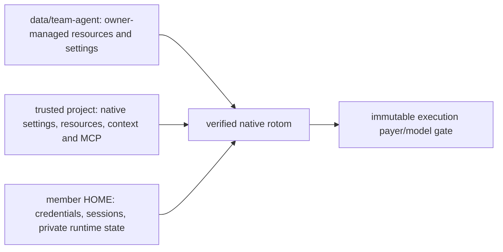

# One Team agent, two configuration layers

The Team has one shared base agent, not a customizable agent per member:

The shared profile is **Team-dedicated**. Nothing imports the service user's personal agent settings, telemetry,
credentials, model defaults, grants or skill memory. Each member still selects an available model on their own
account; the paying member changes model in place, in the same native session. See [PRODUCT.md](PRODUCT.md).

## Shared installation and configuration

Team supports native Agent Extensions only. D9c removes the repository's old `src/server/extensions/` modules.
In both kernel and read-only archive modes, the server extension loader is absent. User `<data>/extensions/`
source files and enabled/disabled records are retained but never loaded or watched; no drop-in dependency link is created.
The old `/api/extensions` listing/toggle/reload endpoints return 404 for authorized requests.
D9c does not migrate data formats: D9b/D9a can reopen the same data without reviving quarantined tasks.
For pre-D9a rollback restrictions, see [LEGACY-ARCHIVE.md](LEGACY-ARCHIVE.md).
For paths, examples, package installation and reload steps, use [AGENT-CONFIGURATION.md](AGENT-CONFIGURATION.md).

The owner manages `<data>/team-agent` using the pinned native resource layout:

| Path                                            | Meaning                                                                                      |
| ----------------------------------------------- | -------------------------------------------------------------------------------------------- |
| `settings.json`                                 | Native shared settings, installed package references, resource paths and model-pattern scope |
| `extensions/`, `skills/`, `prompts/`, `themes/` | Shared agent resources, discovered by the native resolver                                    |
| `AGENTS.md`, `SYSTEM.md`, `APPEND_SYSTEM.md`    | Shared context/system instructions                                                           |
| `mcp.json`                                      | Shared MCP server definitions; never a copy of a member's OAuth credentials                  |
| `team.json` `configFiles`                       | Explicit relative plugin configuration files, for example `plugin/config.json`               |

Install packages into this dedicated profile with the pinned native CLI and an isolated HOME. Do not run installation
against the service user's personal agent directory. Native `settings.json` package references must already be installed:
startup calls the native package resolver with **error on missing**, never implicit installation. Relative resource paths
resolve against the shared profile. Native discovers extension metadata, but Team exposes only its supported slash-command surface.

There is no new package-management web UI. The owner edits the profile on the deployment machine. Finish or stop Team
runs before filesystem edits/package installation; direct OS writes are trusted and are not locked by Team. `/settings` and model
scope editing are owner-only HTTP operations and refuse changes while Team runs are active. Ordinary model selection and
scope cycling remain member-owned and payer-safe. Run `/reload` after resource/settings changes, then refresh the command catalog.

Each native startup derives member resource settings from the shared profile. Credentials, session files and unknown
plugin state are not copied from the profile, moved or deleted. Declared configuration is restored from the shared source.
A command that changes declared member configuration is not silently accepted as personal customization: its attempt
becomes unknown and is not replayed; configure the owner-managed shared profile instead. Declaring a plugin config path
is installation configuration, not adding a command-name adapter.

Managed files carry byte digests. Shared add/change/remove applies to each member at the next authorized startup.
Removing a source or declaration retires only the unchanged managed mirror. An unmanaged collision or changed retiring
file fails closed instead of deleting unknown content. Credential/state names are case-insensitively reserved; configuration
file/parent symlinks and hardlinks are refused before reading or writing. Linked packages remain native resources, not
configuration-copy aliases.

Shared roles can live in `agents/` or declared installed packages. Trusted projects may also define native roles,
subagent settings, chains and package sources; native owned-scope admission still decides which execution modes work.
Member role directories/subagent settings remain derived from the shared profile, not personal customization.
Live tool/child checks compare member resource-selection fields and declared digests with the last derived view.
The shell keeps native owner fd 3 intact through final exec; native child admission owns lifeline and writer validation.
Global npm role discovery uses a shared profile prefix, not ambient service/member global packages.

Unknown plugin files are **unclassified compatibility state**, not proven harmless configuration. A new plugin's known
configuration sources must be reviewed and declared during installation. Do not promise universal isolation for an
arbitrary trusted extension's own filesystem reads/writes. Shared extensions remain trusted native code, not a sandbox.

## Project layer and migration

Native startup uses `--approve`: the configured workspace is a trusted native project, including its executable
extensions and packages. Native loads project settings, templates, themes, `SYSTEM.md`, `APPEND_SYSTEM.md`, MCP and
project/ancestor context. Project system files take native precedence over corresponding shared files. The builtin MCP
loader handles shared/project replacement, partial overrides and credential restrictions; there is no second MCP instance.
Child roles retain native extension selection: a role with no extensions does not implicitly acquire MCP; include
`builtin:mcp` in its extensions when needed.

The automatic skill catalog uses the native resolver over shared and trusted project resources, including project
packages, while excluding undeclared member personal skill directories. Explicit optional child named-skill injection
uses native resolution (including role paths and member-local sources); it does not rewrite the shared base.

Frozen legacy context/skill snapshots retain their stored identity and files. Current shared context/skills/templates
remain additive, while live project context/skills stay excluded from that frozen selection. Other trusted project
settings, executable resources and MCP are live, not frozen.

Computer-use configuration follows native global/project precedence; Team no longer forces environment overrides.
Shared `extensions/pi-computer-use.json` is copied as declared native configuration. Other plugin-specific files need
owner declaration. Trusted project code runs with the service OS user's permissions; this is not filesystem or credential
isolation from that code. Review project packages before enabling this release.

## Optional storage worker

`--storage-worker` opts the native-kernel server into one database worker. It is **off by default**;
`--no-storage-worker` explicitly keeps the D8a in-process path. `PocketApp.open` also accepts
`storageWorker: true`. Combining it with `--no-rotom-kernel` is rejected before acquiring a writer lease.
This is a startup option, not a live toggle. Existing Durable sessions remain readable archives, not executable sessions. `--no-rotom-kernel` permits archive access only; it cannot bypass pending native ownership checks. See [LEGACY-ARCHIVE.md](LEGACY-ARCHIVE.md) for quarantine and rollback.

Only `RotomJournal` and the public Pi Durable `Storage` run in that worker. Harness, transaction callbacks,
mutation queue, mirror coordination, permissions, personal credentials, native processes and the payer gate stay
on the parent. The worker receives explicit data paths and an empty environment, not caller Context values or
credential objects. It is trusted code in the same OS process, **not a sandbox**.

Operations execute FIFO with full transaction boundaries. V8 values are limited to 256 MiB after serialization;
accepted ordinary requests are capped at 128 (including the active request) and 256 MiB combined encoded bytes.
Transport uses 1 MiB pages with one page in flight per direction; it still materializes the whole value at each end.
Three deduplicated, argument-free lifecycle closes have reserved capacity so a full ordinary queue can drain.
These are transport bounds, not a global heap/RSS limit or a maximum queue-wait promise.

An admitted operation must receive its durable ACK. Cancellation can remove a queued request, but cannot declare
a dispatched write rolled back. Startup, active-operation ACK and final exit deadlines are 120 seconds.
Lost ACK, transport failure, unexpected exit or failed close fence the owner; they do not trigger a retry,
restart, parent-side writer, fallback reader or automatic lock removal. A reply exceeding the limit can follow
a completed write and therefore fences as unknown. Acknowledged backend errors retain the public Storage error
classification: only actual `StorageRejected` remains that class; other errors poison the owning Durable Session.

Shutdown stops native admission, drains native/gate/child ownership and startup continuation work, then closes both
stores. Parent execution environments must finish cleanup before final owner close; only its ACK **and** worker exit
release leases. Failed storage must not skip native
shutdown. An incomplete shutdown retains `kernel.lock` and `harness.lock`; a dead parent PID alone never authorizes
breaking them. Recovery requires the existing offline ownership checks, not another live writer.

## Native process lifetime

One native process is retained per immutable conversation segment after successful prompts and commands. MCP connections
and extension memory survive between turns. Each new receipt is authorized separately; the gate denies inference while
idle. Failures/unknown outcomes retire the process, and handoff retires the old binding. Stop does not reuse the stopped
transport. Server shutdown awaits closure of retained processes before releasing its journal lock. No idle eviction or
cross-restart in-memory restoration is claimed; reopening after restart uses the persisted native session.

Public-history seeds (handoff, public fork and import) are sized by the UTF-8 bytes of the serialized
`publicNativeHistory` result. Below 8 MiB, the parent runs the existing file helpers directly; at or above
8 MiB, one operation-owned, short-lived Node worker runs them. Empty history still needs no file or worker.
Both paths durably attach before appending, fsync the file/directory, verify the full readback, and recheck
authorization and Stop before committing the head. The worker path also waits for worker exit; Stop joins it.
Small synchronous file operations cannot be preempted by a queued HTTP Stop; an observed Stop prevents commit.
An uncertain materialization is not retried or reused. An active execution still prevents journal closure.
This is not a storage worker, agent process or shared pool. No new configuration setting or global memory cap is
introduced; large parallel materializations require capacity validation.

Opening an idle native session that runs on one's own account asks the server to start its process after the first
authoritative full view, before composer focus or the first send. Hidden tabs defer until visible; cached/checking
views, other members' sessions, initializing/busy sessions and non-steering members do not ask. Composer focus remains
a fallback (`POST /api/c/:id/warm`, at most once per session every four minutes per tab). The server starts
it only for that member, if they may see, steer and drive the session, on the pinned kernel, after the send's admission
checks. The process's gate has nothing active, so it can spend nothing until a send is admitted; every inference is
still authorized there. Each member keeps at most one unused warm process (warming another session retires the first),
three in all; an unused one retires after five minutes, when its member's account changes, or when they may no longer
drive the session. A send during a warm start waits for it instead of starting a second process. Each warm process
costs memory (about 330 MiB RSS measured) while it waits.

Tracked shared settings/resource metadata and project configuration changes trigger a native reload on the next
authorized receipt. This preserves settings-sheet updates without restarting the process. The freshness hint does not
recursively hash dependency/resource trees; use `/reload` for deeper file changes. Reload may reset extension memory
and reconnect MCP. Each execution stays on its admitted payer/model; only an explicit idle model-selection receipt
can rotate the same-account process's model authorization. Neither project defaults nor child roles can change it.

## Backup and restore of installed packages

`node scripts/data.mjs backup` records `team-agent/npm/node_modules` in `excludedCaches`. This is an explicitly rebuildable
installed dependency cache, not owner configuration or state. A real `package.json` and `package-lock.json` are required and
backed up byte-for-byte. Standard npm `.bin` links are not followed or copied. Declared owner config inside this cache is
rejected, as are unlocked installs; move that configuration outside installed dependencies.

After restore, independently sign in to model accounts as usual. Before enabling native runs, inspect the saved manifests
and explicitly reinstall the shared packages with the deployment toolchain (`npm ci` in `<data>/team-agent/npm`). Native
startup fails closed on missing packages and never installs them automatically. The local test uses offline `npm ci
--ignore-scripts`; real packages may need owner-reviewed lifecycle scripts/network access. Locks do not vendor external
`file:` sources, private registries, edited installed files or arbitrary plugin state. Such content needs a separately
reviewed backup/migration. Other links, including external linked-package paths outside this specific cache, remain refused
by the existing backup contract. Never keep configuration/runtime state inside a rebuildable dependency tree.

Opening this release upgrades the execution journal to schema 6, retaining queued-command fences and adding durable
execution/finalization phases and bounded failure codes. Older releases refuse that schema; do not drop columns or change
the version number. Rollback requires the pre-upgrade backup at its original absolute path, not opening newer execution
data with an older binary. Legacy attempts have no phase evidence: their unknown receipts remain fenced rather than being
automatically reclassified after a dead PID is found. No migration marks them successful.

Native history readback combines the validated local JSONL prefix with native `get_entries` using `since`; native still
supplies unflushed entries and the current branch leaf. A persisted history can exceed 64 MiB without one oversized RPC
response. The 64 MiB limit still applies to a single native event, JSONL entry or unflushed RPC suffix. Those failures stay
unknown and are not automatically continued. If larger in-memory suffixes are required, the next step is a bounded native
paging/streaming protocol, not silently truncating data or raising limits without a memory bound.

## Native pin and subagent defaults

See [Native pin and subagent defaults](CONFIGURATION-NATIVE.md#native-pin-and-subagent-defaults).

## Native slash commands

See [Native slash commands](CONFIGURATION-NATIVE.md#native-slash-commands).

## Outputs and conversation copies

See [Outputs and conversation copies](CONFIGURATION-NATIVE.md#outputs-and-conversation-copies).

## MCP credentials

See [MCP credentials](CONFIGURATION-NATIVE.md#mcp-credentials).

## Forty-five terminal entries and TUI compatibility

See [Forty-five terminal entries and TUI compatibility](CONFIGURATION-NATIVE.md#forty-five-terminal-entries-and-tui-compatibility).

## Recover an existing member's browser sign-in

See [Recover an existing member's browser sign-in](CONFIGURATION-SESSIONS.md#recover-an-existing-members-browser-sign-in).

## Stored image previews

See [Stored image previews](CONFIGURATION-SESSIONS.md#stored-image-previews).

## Session subscriptions

See [Session subscriptions](CONFIGURATION-SESSIONS.md#session-subscriptions).

## Session-list updates

See [Session-list updates](CONFIGURATION-SESSIONS.md#session-list-updates).

## Saved session copies

See [Saved session copies](CONFIGURATION-SESSIONS.md#saved-session-copies).

## Streaming Markdown

See [Streaming Markdown](CONFIGURATION-SESSIONS.md#streaming-markdown).

## Long sessions

See [Long sessions](CONFIGURATION-SESSIONS.md#long-sessions).

## Changes view freshness

See [Changes view freshness](CONFIGURATION-SESSIONS.md#changes-view-freshness).

## Optional TLS and HTTP/2

See [Optional TLS and HTTP/2](CONFIGURATION-SESSIONS.md#optional-tls-and-http2).

## Verification

Use [VERIFICATION.md](VERIFICATION.md). The native/browser, resource, MCP, Goal and inventory scripts use temporary data
and synthetic loopback providers. They do not authorize a real model account, real MCP service, desktop action, external
upload or production deployment. Old project-extension proofs must be migrated explicitly, not cited as this new contract.
