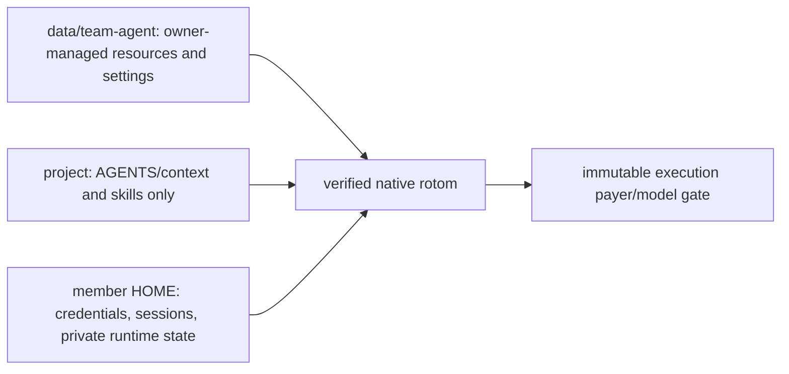

# One Team agent, two configuration layers

The Team has one shared base agent, not a customizable agent per member:

The shared profile is **Team-dedicated**. Nothing imports the service user's personal agent settings, telemetry,
credentials, model defaults, grants or skill memory. Each member still selects an available model on their own
account; changing model uses the existing immutable Team handoff. See [PRODUCT.md](PRODUCT.md).

## Shared installation and configuration

The owner manages `<data>/team-agent` using the pinned native resource layout:

| Path                                            | Meaning                                                                                      |
| ----------------------------------------------- | -------------------------------------------------------------------------------------------- |
| `settings.json`                                 | Native shared settings, installed package references, resource paths and model-pattern scope |
| `extensions/`, `skills/`, `prompts/`, `themes/` | Shared agent resources, discovered by the native resolver                                    |
| `AGENTS.md`, `SYSTEM.md`, `APPEND_SYSTEM.md`    | Shared context/system instructions                                                           |
| `mcp.json`                                      | Shared MCP server definitions; never a copy of a member's OAuth credentials                  |
| `team.json` `configFiles`                       | Explicit relative plugin configuration files, for example `plugin/config.json`               |

Install packages into this dedicated profile with the pinned native CLI and an isolated HOME. Do not run installation
against the service user's personal agent directory. Native `settings.json` package references must already be installed:
startup calls the native package resolver with **error on missing**, never implicit installation. Relative resource paths
resolve against the shared profile. A new extension's registered names need no Team command-dispatch changes.

There is no new package-management web UI. The owner edits the profile on the deployment machine. Finish or stop Team
runs before filesystem edits/package installation; direct OS writes are trusted and are not locked by Team. `/settings` and model
scope editing are owner-only HTTP operations and refuse changes while Team runs are active. Ordinary model selection and
scope cycling remain member-owned and payer-safe. Refresh the command catalog after resource changes.

Each native startup derives member resource settings from the shared profile. Credentials, session files and unknown
plugin state are not copied from the profile, moved or deleted. Declared configuration is restored from the shared source.
A command that changes declared member configuration is not silently accepted as personal customization: its attempt
becomes unknown and is not replayed; configure the owner-managed shared profile instead. Declaring a plugin config path
is installation configuration, not adding a command-name adapter.

Managed files carry byte digests. Shared add/change/remove applies to each member at the next authorized startup.
Removing a source or declaration retires only the unchanged managed mirror. An unmanaged collision or changed retiring
file fails closed instead of deleting unknown content. Credential/state names are case-insensitively reserved; configuration
file/parent symlinks and hardlinks are refused before reading or writing. Linked packages remain native resources, not
configuration-copy aliases.

Shared roles can live in `agents/` or declared installed packages. Member role directories/subagent settings and project subagent
settings, role/chain files and agent-package manifests are rejected before native startup. Ordinary project packages and
allowed AGENTS/skills still work. Native subagent tool calls and queued slash commands recheck the policy during a live run.
Live/child checks also compare resource-selection fields and declared file digests with the last derived view; later
member package paths, executable autodiscovery and context/config overrides cannot become child configuration.
Child CLI arguments use the pinned parser; `--approve`/`-a` and extensions outside canonical shared/bundled authority are
refused. The shell keeps native owner fd 3 intact through final exec. Global npm role discovery uses a shared profile prefix,
not ambient service/member global packages.

Unknown plugin files are **unclassified compatibility state**, not proven harmless configuration. A new plugin's known
configuration sources must be reviewed and declared during installation. Do not promise universal isolation for an
arbitrary trusted extension's own filesystem reads/writes. Shared extensions remain trusted native code, not a sandbox.

## Project layer and migration

Native startup uses `--no-approve`, even if `/trust` or an earlier MCP login saved a trust grant. The core native resource
loader therefore omits project extensions, packages, settings, templates, themes and MCP definitions. Native project and
ancestor AGENTS/context still load. The Team skill hook uses the native resolver with **only** the project's `skills` key;
project package/extension settings cannot participate in that resolution. Project `.pi/skills` and ancestor `.agents/skills`
remain available. Member personal skill directories do not load.

Move previously supported project MCP definitions, extensions and agent settings into the owner-managed shared profile.
Do not blindly copy `.pi/settings.json`, personal skills or auth files. Frozen legacy context/skill snapshots retain their
stored identity. Their old context files and receipts are not rewritten: current shared AGENTS, skills and templates are
additive at native startup, while live project context/skills stay excluded from the frozen selection. This deliberately
migrates the old “freeze all agent configuration” behavior to one current shared base plus frozen project context.

The bundled computer-use extension independently reads `.pi/computer-use.json`. Team sets all four supported environment
overrides from shared `extensions/pi-computer-use.json`, including native defaults, so project values cannot override them.
The native pi-subagents reader is separately checked as described above; `--no-approve` alone does not enforce it.
Other plugin-specific loaders require source/API verification during owner installation. This is not filesystem isolation
against trusted code or a concurrent OS actor deliberately rewriting the protected resource tree.

## Backup and restore of installed packages

`node scripts/data.mjs backup` records `team-agent/npm/node_modules` in `excludedCaches`. This is an explicitly rebuildable
installed dependency cache, not owner configuration or state. A real `package.json` and `package-lock.json` are required and
backed up byte-for-byte. Standard npm `.bin` links are not followed or copied. Declared owner config inside this cache is
rejected, as are unlocked installs; move that configuration outside installed dependencies.

After restore, independently sign in to model accounts as usual. Before enabling native runs, inspect the saved manifests
and explicitly reinstall the shared packages with the deployment toolchain (`npm ci` in `<data>/team-agent/npm`). Native
startup fails closed on missing packages and never installs them automatically. The local test uses offline `npm ci
--ignore-scripts`; real packages may need owner-reviewed lifecycle scripts/network access. Locks do not vendor external
`file:` sources, private registries, edited installed files or arbitrary plugin state. Such content needs a separately
reviewed backup/migration. Other links, including external linked-package paths outside this specific cache, remain refused
by the existing backup contract. Never keep configuration/runtime state inside a rebuildable dependency tree.

Opening this release upgrades the execution journal to schema 5 for queued-command no-replay fences. Older releases refuse
that schema; do not drop its markers or change the version number. Rollback requires the pre-upgrade backup at its original
absolute path, not opening newer execution data with an older binary.

## Native pin and subagent defaults

The pin remains rotom 0.1.21; no native source, installed dependency or pin is changed by this work. Derived native settings
keep automatic retries/compaction disabled and retain the Team's disabled delegate/oracle/researcher defaults. The safe
builtin roles remain scout, worker and reviewer. This is not an OS sandbox or a claim that a plugin cannot read project files.

Optional subagent named-skill/memory injection needs attested sources. Owned async launch descriptors with no injection retain
normal structured single-child execution; nonempty name-only descriptors, role memory and selected project refinements are
refused before child inference. Private files stay unchanged. User-provided `workflowScript` is explicitly unsupported in the
user-approved verified subset and rejected before execution: native scoped ownership refuses synchronous controllers and
async workflow delivery/lifetime has no verified bridge. Internal single-child normalization is not programmable workflow
coverage. Native ownership and pin remain unchanged. See [NATIVE-COMMAND-COMPATIBILITY.md](NATIVE-COMMAND-COMPATIBILITY.md).
Normal parent/project skill loading is unaffected.

## Native slash commands

Typing `/` uses the pinned runtime's builtin catalog, not Pocket's old hardcoded list. Dynamic extensions, prompt
templates and skills come from native `get_commands`. `GET /api/c/:id/prompts` reads a snapshot; it never starts native code. Opening slash suggestions through composer input, or choosing **Refresh shared agent commands on my account**, explicitly starts the trusted native runtime under the member's ordinary permissions, admission and lease. Discovery denies Team
inference and credential-refresh requests. It needs no paid prompt, but shared extension startup is still trusted executable
code, not a sandbox. An idle session owned by another member is first handed over using public history.

Snapshots belong to one member, segment and immutable binding. Another member never receives their HOME-derived
descriptions. Snapshots persist and do not disappear after 30 idle seconds. Freshness distinguishes undiscovered, live, last-known and configuration-changed. The bounded fingerprint reads declared configuration and immediate resource metadata, never npm dependency trees or
symlink targets. Linked/external code and nested file edits require explicit Refresh or `/reload`; this is a freshness hint,
not a complete content attestation. Settings/failure invalidation retains the last-known names; authorized startup/reload captures again. This is not a file-watching or freshness guarantee for arbitrary external resources: refresh after editing configuration. Catalog errors are visible. Failed discovery needs explicit review/refresh, not automatic retry after the cache TTL.
Unknown discovery blocks startup even with a new request ID; exact receipt readback starts no process. Known command-sheet
input does not race an automatic discovery. Dispatch validates the current native registry. Unknown names and private `team-kernel-*` commands do
not become model prompts. Native skills/templates are expanded by native APIs, including queued input. Selecting a
skill or prompt-template suggestion only fills the draft; submitting it starts the model request.

| Command                                                          | Team/native behavior                                                                                                                                                                                                                                                                   |
| ---------------------------------------------------------------- | -------------------------------------------------------------------------------------------------------------------------------------------------------------------------------------------------------------------------------------------------------------------------------------- |
| `/model`, `/thinking`, `/scoped-models`                          | Personal model picker and owner-managed shared native model-pattern scope. A real Team handoff creates a new immutable binding; an active run is never mutated. Scope cycling uses that same path.                                                                                     |
| `/name`                                                          | Native `set_session_name`, with confirmed readback mirrored into Team. Native defers JSONL creation before the first conversation; Team preserves the confirmed name and restores it on the next startup.                                                                              |
| `/new`, `/resume`                                                | Create a separate Team native conversation, or choose a visible existing one. No receipt is silently attached to a different native session.                                                                                                                                           |
| `/fork`                                                          | Select a native user-entry ID; create a Team-safe public-history seed **before** that user message. Restore its text as a draft, never submit it automatically. This is not a call to native `forkSession`.                                                                            |
| `/clone`                                                         | Native `createBranchedSession` for the same member; public-history seed for a different member.                                                                                                                                                                                        |
| `/tree`                                                          | Select an entry in the member's native segment. Native `ctx.navigateTree` changes the branch; optional **Summarize** (or `/tree <entryId> --summarize`) runs the native summarizer through the same payer/model gate. Persisted summary usage is recorded; absent usage stays unknown. |
| `/export`                                                        | Authenticated, member-private attachment using native JSONL branch serialization or the native HTML exporter. JSONL is the current branch, not a byte-for-byte full-tree copy. HTML retains the native exporter's tree behavior.                                                       |
| `/import`                                                        | Native parse/migration of a JSONL file in this workspace or this session's uploads, bounded to 50 MiB; a new Team conversation receives only public history, never imported provider state.                                                                                            |
| `/settings`                                                      | Native `SettingsManager` execution settings: steering/follow-up, image options, skill commands and model scope. Owner-only shared settings; project settings do not take precedence. Team automatic retries/compaction remain disabled.                                                |
| `/compact`, `/reload`, `/session`, `/copy`                       | Native compaction, resource reload, state/statistics and last-assistant-text clipboard result.                                                                                                                                                                                         |
| `/login`, `/logout`, `/hotkeys`, `/changelog`, `/trust`, `/quit` | Personal provider sheet, web shortcuts, pinned product update guidance, native trust choices (which cannot enable project agent configuration), and stopping/leaving this view respectively. Project trust does not create an OS boundary.                                             |
| `/mcp`, `/mcp login <server>`, `/mcp logout <server>`            | The existing member-owned browserless sign-in bridge. These adapters first verify actual native registration.                                                                                                                                                                          |
| `/qoder-models`, `/qoder-credits`                                | The member's provider catalog/quota API in the credential-owning parent. Results are private HTTP responses, not room broadcasts. Account-changing/busy operations are refused; snapshots are not per-request debit or financial cost.                                                 |
| `/goal` and other registered extensions                          | Actual native handlers. Goal keeps its process, receipt, member and gate while active/waiting; native deadlines, Pause, Resume, Stop and plain input control that lifecycle.                                                                                                           |

**Only `/share` and `/bug` are explicitly excluded from this release.** They are absent from executable suggestions;
manual invocation is rejected before native startup, inference or upload. No sharing/auth service or diagnostic runner
is provided. Other commands may still refuse operations for permissions, an active/unknown lease, unavailable accounts
or invalid native inputs; these refusals are not simulated success.

### Branch interaction and outcomes

The pinned RPC `navigateTree` adapter returns only `cancelled`; it drops the native session's `editorText`, `aborted`
and summary result. Team therefore preserves native cancellation, extracts draft text with the pinned native
`contentText(content, "")` helper **after successful, non-no-op navigation**, and reads only newly persisted native
summary entries. The cancellation reason is unavailable, not inferred. String content and multiple text blocks use
native concatenation; image-only/empty entries are not offered by the fork selector. Cancellation, error and unknown
outcomes leave an existing draft untouched. Tree result readback is durable and does not replay navigation.

The shared transcript and the native snapshot API's `messages` are **immutable audit history**, including abandoned
branches. Navigation does not delete those records. A notice identifies this after branching; `/tree` labels active
versus abandoned branch entries. Native JSONL export follows the selected branch. Compaction may further reduce the
context sent to a model; branch membership is not a promise that every ancestor message is sent verbatim.

Native status/widget events replace or clear keyed live slots; only real `notify` events create notices. A `handled`
receipt means the handler completed, not that a requested navigation occurred: inspect its cancellation/result.
Side-effectful slash handlers use `command` receipts and are not automatically continued after unknown outcomes.
Only native-discovered prompt templates/skills become ordinary recoverable `prompt` operations. Existing stored
receipts stay readable and are not rewritten. Goal Stop may remain unknown; it does not certify external effects.

## MCP credentials

MCP server definitions are shared; OAuth tokens remain in each member's
`kernel-homes/<member>/.pi/agent/mcp-auth.json`. The browserless native sign-in bridge never opens the service user's browser.
Only the initiating member's loopback callback origin/path is accepted. The native MCP CLI runs from the shared profile,
not the project, because that subcommand has no `--no-approve` option. Signing in does not grant project extension access.

Do not put personal access tokens or global-account credentials in shared config. Environment lookups use the scrubbed
member environment, not the service's ambient secrets. Backups/restores continue to exclude refresh grants; members sign
in again. Declared config paths cannot name auth, model stores or session storage.

## Forty-five terminal entries and TUI compatibility

See [NATIVE-COMMAND-COMPATIBILITY.md](NATIVE-COMMAND-COMPATIBILITY.md) for every comparison row and actual coverage.
The isolated terminal comparison contains 24 builtins, 15 extension commands and 6 skill commands. The empty shared Team
profile has 39 native entries, or 37 allowed catalog entries (not 37 working interactions) after the two explicit exclusions. This is a measured inventory,
not proof that all entries have equivalent interactions.

`/context` and `/llama` require real TUI/custom UI. Pinned RPC cannot supply it; a handled response containing a TUI-only
warning is not success. `/context` is not installed into the initial Team profile while this is blocked. The five personal
skills are deliberately uninstalled by user choice, not permission to publish private memory/preferences/device lessons. Neither condition is silently reclassified as an additional product exclusion.

Production TUI transport is outside this delivery scope. A bounded OS-PTY prototype renders and interacts with an actual native custom component, preserving an isolated member
session and an unknown command receipt. It is **not** a production transport: public extension APIs expose no generic
command-completion/error observer to the external TUI frontend. Terminal exit or visual messages are not sufficient to
settle a receipt. No context.mode spoofing, native monkeypatch or reconstructed `/context` report is used.

## Verification

Use [VERIFICATION.md](VERIFICATION.md). The native/browser, resource, MCP, Goal and inventory scripts use temporary data
and synthetic loopback providers. They do not authorize a real model account, real MCP service, desktop action, external
upload or production deployment. Old project-extension proofs must be migrated explicitly, not cited as this new contract.
