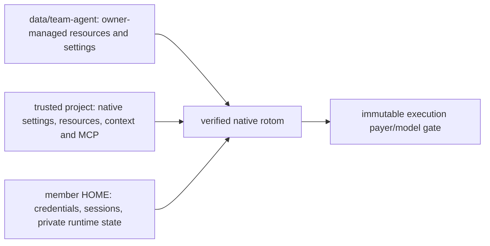

# One Team agent, two configuration layers

The Team has one shared base agent, not a customizable agent per member:

The shared profile is **Team-dedicated**. Nothing imports the service user's personal agent settings, telemetry,
credentials, model defaults, grants or skill memory. Each member still selects an available model on their own
account; the paying member changes model in place, in the same native session. See [PRODUCT.md](PRODUCT.md).

## Shared installation and configuration

Team supports native Agent Extensions only. In Team kernel mode, the inherited server extension loader is absent:
`src/server/extensions/` and `<data>/extensions/` are not loaded or watched, no drop-in dependency link is created,
and the old `/api/extensions` listing/toggle/reload endpoints return 404 for authorized requests. Existing files and
switch records are retained. The non-Team legacy runtime still owns those modules; it is not an Agent configuration path.
For paths, examples, package installation and reload steps, use [AGENT-CONFIGURATION.md](AGENT-CONFIGURATION.md).

The owner manages `<data>/team-agent` using the pinned native resource layout:

| Path                                            | Meaning                                                                                      |
| ----------------------------------------------- | -------------------------------------------------------------------------------------------- |
| `settings.json`                                 | Native shared settings, installed package references, resource paths and model-pattern scope |
| `extensions/`, `skills/`, `prompts/`, `themes/` | Shared agent resources, discovered by the native resolver                                    |
| `AGENTS.md`, `SYSTEM.md`, `APPEND_SYSTEM.md`    | Shared context/system instructions                                                           |
| `mcp.json`                                      | Shared MCP server definitions; never a copy of a member's OAuth credentials                  |
| `team.json` `configFiles`                       | Explicit relative plugin configuration files, for example `plugin/config.json`               |

Install packages into this dedicated profile with the pinned native CLI and an isolated HOME. Do not run installation
against the service user's personal agent directory. Native `settings.json` package references must already be installed:
startup calls the native package resolver with **error on missing**, never implicit installation. Relative resource paths
resolve against the shared profile. Native discovers extension metadata, but Team exposes only its supported slash-command surface.

There is no new package-management web UI. The owner edits the profile on the deployment machine. Finish or stop Team
runs before filesystem edits/package installation; direct OS writes are trusted and are not locked by Team. `/settings` and model
scope editing are owner-only HTTP operations and refuse changes while Team runs are active. Ordinary model selection and
scope cycling remain member-owned and payer-safe. Run `/reload` after resource/settings changes, then refresh the command catalog.

Each native startup derives member resource settings from the shared profile. Credentials, session files and unknown
plugin state are not copied from the profile, moved or deleted. Declared configuration is restored from the shared source.
A command that changes declared member configuration is not silently accepted as personal customization: its attempt
becomes unknown and is not replayed; configure the owner-managed shared profile instead. Declaring a plugin config path
is installation configuration, not adding a command-name adapter.

Managed files carry byte digests. Shared add/change/remove applies to each member at the next authorized startup.
Removing a source or declaration retires only the unchanged managed mirror. An unmanaged collision or changed retiring
file fails closed instead of deleting unknown content. Credential/state names are case-insensitively reserved; configuration
file/parent symlinks and hardlinks are refused before reading or writing. Linked packages remain native resources, not
configuration-copy aliases.

Shared roles can live in `agents/` or declared installed packages. Trusted projects may also define native roles,
subagent settings, chains and package sources; native owned-scope admission still decides which execution modes work.
Member role directories/subagent settings remain derived from the shared profile, not personal customization.
Live tool/child checks compare member resource-selection fields and declared digests with the last derived view.
The shell keeps native owner fd 3 intact through final exec; native child admission owns lifeline and writer validation.
Global npm role discovery uses a shared profile prefix, not ambient service/member global packages.

Unknown plugin files are **unclassified compatibility state**, not proven harmless configuration. A new plugin's known
configuration sources must be reviewed and declared during installation. Do not promise universal isolation for an
arbitrary trusted extension's own filesystem reads/writes. Shared extensions remain trusted native code, not a sandbox.

## Project layer and migration

Native startup uses `--approve`: the configured workspace is a trusted native project, including its executable
extensions and packages. Native loads project settings, templates, themes, `SYSTEM.md`, `APPEND_SYSTEM.md`, MCP and
project/ancestor context. Project system files take native precedence over corresponding shared files. The builtin MCP
loader handles shared/project replacement, partial overrides and credential restrictions; there is no second MCP instance.
Child roles retain native extension selection: a role with no extensions does not implicitly acquire MCP; include
`builtin:mcp` in its extensions when needed.

The automatic skill catalog uses the native resolver over shared and trusted project resources, including project
packages, while excluding undeclared member personal skill directories. Explicit optional child named-skill injection
uses native resolution (including role paths and member-local sources); it does not rewrite the shared base.

Frozen legacy context/skill snapshots retain their stored identity and files. Current shared context/skills/templates
remain additive, while live project context/skills stay excluded from that frozen selection. Other trusted project
settings, executable resources and MCP are live, not frozen.

Computer-use configuration follows native global/project precedence; Team no longer forces environment overrides.
Shared `extensions/pi-computer-use.json` is copied as declared native configuration. Other plugin-specific files need
owner declaration. Trusted project code runs with the service OS user's permissions; this is not filesystem or credential
isolation from that code. Review project packages before enabling this release.

## Native process lifetime

One native process is retained per immutable conversation segment after successful prompts and commands. MCP connections
and extension memory survive between turns. Each new receipt is authorized separately; the gate denies inference while
idle. Failures/unknown outcomes retire the process, and handoff retires the old binding. Stop does not reuse the stopped
transport. Server shutdown awaits closure of retained processes before releasing its journal lock. No idle eviction or
cross-restart in-memory restoration is claimed; reopening after restart uses the persisted native session.

Tracked shared settings/resource metadata and project configuration changes trigger a native reload on the next
authorized receipt. This preserves settings-sheet updates without restarting the process. The freshness hint does not
recursively hash dependency/resource trees; use `/reload` for deeper file changes. Reload may reset extension memory
and reconnect MCP. The process stays on its admitted payer/model; neither project defaults nor child roles can change
that authorization.

## Backup and restore of installed packages

`node scripts/data.mjs backup` records `team-agent/npm/node_modules` in `excludedCaches`. This is an explicitly rebuildable
installed dependency cache, not owner configuration or state. A real `package.json` and `package-lock.json` are required and
backed up byte-for-byte. Standard npm `.bin` links are not followed or copied. Declared owner config inside this cache is
rejected, as are unlocked installs; move that configuration outside installed dependencies.

After restore, independently sign in to model accounts as usual. Before enabling native runs, inspect the saved manifests
and explicitly reinstall the shared packages with the deployment toolchain (`npm ci` in `<data>/team-agent/npm`). Native
startup fails closed on missing packages and never installs them automatically. The local test uses offline `npm ci
--ignore-scripts`; real packages may need owner-reviewed lifecycle scripts/network access. Locks do not vendor external
`file:` sources, private registries, edited installed files or arbitrary plugin state. Such content needs a separately
reviewed backup/migration. Other links, including external linked-package paths outside this specific cache, remain refused
by the existing backup contract. Never keep configuration/runtime state inside a rebuildable dependency tree.

Opening this release upgrades the execution journal to schema 6, retaining queued-command fences and adding durable
execution/finalization phases and bounded failure codes. Older releases refuse that schema; do not drop columns or change
the version number. Rollback requires the pre-upgrade backup at its original absolute path, not opening newer execution
data with an older binary. Legacy attempts have no phase evidence: their unknown receipts remain fenced rather than being
automatically reclassified after a dead PID is found. No migration marks them successful.

Native history readback combines the validated local JSONL prefix with native `get_entries` using `since`; native still
supplies unflushed entries and the current branch leaf. A persisted history can exceed 64 MiB without one oversized RPC
response. The 64 MiB limit still applies to a single native event, JSONL entry or unflushed RPC suffix. Those failures stay
unknown and are not automatically continued. If larger in-memory suffixes are required, the next step is a bounded native
paging/streaming protocol, not silently truncating data or raising limits without a memory bound.

## Native pin and subagent defaults

The pin is rotom 0.1.26. Team does not override native retry, compaction or builtin role settings. An empty shared
profile uses native defaults: automatic retry enabled (3 retries, 2-second exponential base delay, 60-second maximum),
automatic compaction enabled (16,384 reserve tokens and approximately 20,000 recent tokens retained), and all five builtin
roles: scout, worker, reviewer, delegate and oracle (alias advisor for oracle). Compaction triggers when the
native context estimate exceeds the selected model's context window minus reserve tokens, and uses native overflow
recovery. Context windows come from model metadata, not a Team-wide limit. Shared `compaction.modelOverrides` and
`retry.provider` settings retain native precedence. Provider request retry options are forwarded unchanged; the pinned
OpenAI provider helper defaults to zero HTTP retries when no override is set. Agent-level retry is separate and defaults
to three. Automatic compaction usage and rotom's evidence-preserving reducer usage are journaled under the same prompt payer;
missing usage remains unknown. Unless an owner/shared or trusted project `sol-pi.json` explicitly selects otherwise,
Team writes native SoL-Pi configuration with rotom's feature defaults and the admitted provider/model. Shared
`sol-pi.json` is a managed configuration file. The reducer may run only on the admitted provider/model: an explicitly
selected foreign reducer is blocked and leaves the operation unknown rather than charging an unbound account. All inference, including
retry, compaction and reduction, still passes through the fixed payer/model gate. Unknown Team operations and
credential refreshes are not replayed. Existing managed role/recovery overrides are replaced from the shared profile on
the next startup; private/unclassified state is untouched. This is not an OS sandbox or a claim that a plugin cannot read
project files.

Optional child named skills, user/project memory and existing project refinement overlays use native injection.
User memory stays under the paying member's native agent directory and is never copied on handoff. Project memory is
shared by that project. Native read/write and size limits apply. Private routing is not secrecy after a model quotes
memory into a shared conversation, and is not an OS sandbox. The old Team recovery-descriptor injection gate is removed;
native owned admission and the fd-3 lifeline remain authoritative.

`workflowScript` remains blocked in Team RPC. Pinned native synchronous controllers and standalone foreground launches
are refused by owned scope. Native asynchronous controllers are supported natively, but the RPC UI skips the headless
auto-drain; `agent_settled` and `ctx.waitForIdle()` do not prove controller/child closure. The fixed pin exports no public
drain bridge. Enabling this requires a supported native drain request/response plus Team integration and closure tests,
not a new Team executor, status-file polling, or spoofing `hasUI`. Native refinement generation also uses an unsupported
foreground reviewer; this release enables existing overlays, not generation. See
[NATIVE-COMMAND-COMPATIBILITY.md](NATIVE-COMMAND-COMPATIBILITY.md).

## Native slash commands

Typing `/` uses pinned native metadata. Dynamic extensions, prompt templates and skills from native `get_commands`
are admitted by default; Team only protects terminal-only builtins for credentials, trust, uploads and session lifecycle,
plus private `team-kernel-*` commands. `GET /api/c/:id/prompts` reads a snapshot; it never starts native code. Opening slash suggestions through composer input, or choosing **Refresh shared agent commands on my account**, explicitly starts the trusted native runtime under the member's ordinary permissions, admission and lease. Discovery denies Team
inference and credential-refresh requests. It needs no paid prompt, but shared extension startup is still trusted executable
code, not a sandbox. An idle session owned by another member is first handed over using public history.

Snapshots belong to one member, segment and immutable binding. Another member never receives their HOME-derived
descriptions. Snapshots persist and do not disappear after 30 idle seconds. Freshness distinguishes undiscovered, live, last-known and configuration-changed. The bounded fingerprint reads declared configuration and immediate resource metadata, never npm dependency trees or
symlink targets. Linked/external code and nested file edits require explicit Refresh or `/reload`; this is a freshness hint,
not a complete content attestation. Settings/failure invalidation retains the last-known names; authorized startup/reload captures again. This is not a file-watching or freshness guarantee for arbitrary external resources: refresh after editing configuration. Catalog errors are visible. Failed discovery needs explicit review/refresh, not automatic retry after the cache TTL.
Unknown discovery blocks startup even with a new request ID; exact receipt readback starts no process. Known command-sheet
input does not race an automatic discovery. Dispatch validates the current native registry. Unknown names and private `team-kernel-*` commands do
not become model prompts. Native skills/templates are expanded by native APIs, including queued input. Selecting a
skill or prompt-template suggestion only fills the draft; submitting it starts the model request.
After the native registry admits that input as a skill/template, submit returns its active prompt receipt and the
composer clears the submitted draft without waiting for inference to finish. Side-effectful commands still wait for
their own result; cancellation/rejection/unknown does not clear the draft.

Team's fixed Web adapters remain `settings, model, thinking, tree, fork, clone, compact, reload`; Goal, context, account
commands and other native extensions use command-specific or native handlers after live discovery. The protected
terminal-only builtins are `scoped-models, export, import, share, bug, changelog, hotkeys, trust, login, logout, new,
resume, quit`. Resolving native name precedence before protection prevents a same-name template from bypassing a
protected builtin. The actual native registry is checked again immediately before idle or queued dispatch, including
when a retained process reloads resources or registers a new command. Separate Team APIs and internal lifecycle/recovery
operations are unchanged. Catalog entries also carry Web guidance, not another registry. `/llama` remains visible as
Terminal only but cannot execute in Web. MCP supports the personal sign-in manager and login/logout/reconnect syntax;
owner server-definition/enable/exposure commands and extra positional arguments are rejected. Bare `/subagents-stop`
requires an explicit run id. Unknown trusted extensions are labeled unverified; skills/templates explicitly warn about
inference and service-machine prerequisites. See the complete dynamic-command audit in the compatibility document.

`/context` and `/context usage` open a Web context-usage sheet; `/context injections` groups current request injections
by native/extension source. Both reuse pinned `pi-context-view` capture and measurement code, never make a paid/silent
probe, and return only labels/counts—not raw prompt, message or tool text. `/context config` is refused because plugin
configuration belongs to the owner-managed shared profile. Context commands are read-only receipts, idempotent by
request ID, and busy-gated rather than queued into a running prompt. The usage sheet follows the pinned terminal's
16×16 proportional map, category colors, token precision and window percentages. Tool Output opens its measured
per-tool breakdown by default. Auto-Compact Buffer is capped at remaining window space, and Free Space excludes it;
an unknown window stays unknown. Desktop map/legend columns stack on phones. Browser colors use the active Team
theme; terminal custom color/map-size overrides, Fit zoom and raw-content previews are not ported.

Tab and partial-name Enter fill the draft without executing. Complete-name Enter runs the command. Thinking and fork
have dedicated keyboard selectors; settings writes remain owner-only and busy-gated. Bare Goal opens a Web manager,
with native grammar, personal billing and no-replay fences intact. Its safety-settings editor remains unavailable.
The composer shows a separate current thinking control, including `off`. During a live prompt, only its paying member
with continue/driver permission may change thinking, through the picker or `/thinking <level>`. Native clamps the level;
the next model request uses it, not the response already streaming. The same process, payer, model, segment and initial
receipt binding remain unchanged. Native thinking history preserves the level after process retirement/restart; current
live readback takes precedence while the process is retained. A durable command-input fence prevents unknown writes
from being replayed or making the parent prompt eligible for automatic continuation. Startup, finalization, Stop and
unknown operations still refuse live changes. When idle, the paying member's own change stays in the same native
session and segment, so project hooks keep seeing one session id. A thinking-only change runs as the native `/thinking`
command receipt on the retained process. A model or account change of the same member is one `/model` command receipt:
its intent and the segment's current model commit together, the idle process retires, and native restarts on the same
session file with the new model, then records `model_change` and reapplies the selected thinking level. The segment's
original binding stays the immutable identity anchor; each attempt keeps its own binding for response validation and
usage. A known rejection restores the previous model; an unknown outcome keeps the new one and stays fenced. A payer
or kernel change still uses the existing handoff path. Session-list model labels read the current native journal binding,
not the legacy Durable agent's stale preference. A single batch read joins current conversation heads and model overrides,
without a per-row native session lookup or a second model-state cache. Model switches and server restarts do not change historical receipt bindings.

Browser/computer-use refer to the service host, not the viewer's device. Quota results remain member-private account
snapshots. See [NATIVE-COMMAND-COMPATIBILITY.md](NATIVE-COMMAND-COMPATIBILITY.md) for every supported interaction and limit.

### Branch interaction and outcomes

The pinned RPC `navigateTree` adapter returns only `cancelled`; it drops the native session's `editorText`, `aborted`
and summary result. Team therefore preserves native cancellation, extracts draft text with the pinned native
`contentText(content, "")` helper **after successful, non-no-op navigation**, and reads only newly persisted native
summary entries. The cancellation reason is unavailable, not inferred. String content and multiple text blocks use
native concatenation; image-only/empty entries are not offered by the fork selector. Cancellation, error and unknown
outcomes leave an existing draft untouched. Tree result readback is durable and does not replay navigation.

The shared transcript and the native snapshot API's `messages` are **immutable audit history**, including abandoned
branches. Navigation does not delete those records. A notice identifies this after branching; `/tree` labels active
versus abandoned branch entries. Native JSONL export follows the selected branch. Compaction may further reduce the
context sent to a model; branch membership is not a promise that every ancestor message is sent verbatim.

Native status/widget events replace or clear keyed live slots; only real `notify` events create notices. A `handled`
receipt means the handler completed, not that a requested navigation occurred: inspect its cancellation/result.
Side-effectful slash handlers use `command` receipts and are not automatically continued after unknown outcomes.
Only native-discovered prompt templates/skills become ordinary recoverable `prompt` operations. Existing stored
receipts stay readable and are not rewritten. Goal Stop may remain unknown; it does not certify external effects.

## Outputs and conversation copies

The **Outputs** entry groups successful `write`/`edit` records and separately published artifacts. It uses the already
public transcript projection, not a scan of the server filesystem, raw native history, parsed shell commands or script
source. Successful codemode child-call metadata is included, even if a later script step failed. Failed/pending writes
and clipped direct path arguments do not create links. Only child metadata with an already-public path is indexed;
native nested-call records without public paths are not mined for arguments and remain accessible via Browse project
files. Existing file-view/download authorization remains authoritative.
The button count and sheet share this history-based definition. Browse project files finds shell-created and other
unindexed outputs without enabling the legacy artifact extension.

This is an audit-history shortcut, **not** a manifest of the active native branch, an existence check, a saved file
version or a new filesystem permission. Inherited/discarded history may refer to files that have changed or disappeared;
opening resolves the current path through the existing authorized endpoint. Clones/forks share the project folder.
The UI states these limits instead of implying independent file copies. Native `/clone` keeps the visible source title
plus `· Copy`; an earlier-message fork uses `· Fork`. Imported source `session_info` remains in audit history but cannot
rename the destination. Subsequent explicit live naming still works.

## MCP credentials

MCP server definitions can be shared or project-local; OAuth tokens remain in each member's
`kernel-homes/<member>/.pi/agent/mcp-auth.json`. The browserless native sign-in bridge never opens the service user's browser.
Only the initiating member's loopback callback origin/path is accepted. The MCP-only native CLI runs from the project's
cwd, so relative stdio arguments and config precedence match Agent execution. Its native trust record enables project MCP
parsing; this CLI exits before project extension/package loading. Agent/child startup independently grants native project
trust. Project `auth.provider` remains rejected by the native
parser: a repository cannot redirect a member's model login token. Config add/edit/remove changes the next startup and
command freshness; `/reload` reconnects native MCP. Project workspaces remain separately backed up.

Do not put personal access tokens or global-account credentials in shared config. Environment lookups use the scrubbed
member environment, not the service's ambient secrets. Backups/restores continue to exclude refresh grants; members sign
in again. Declared config paths cannot name auth, model stores or session storage.

## Forty-five terminal entries and TUI compatibility

See [NATIVE-COMMAND-COMPATIBILITY.md](NATIVE-COMMAND-COMPATIBILITY.md) for the supported interactions and actual coverage.
The attested 0.1.22 terminal comparison contains 24 builtins, 15 extension commands and 6 skill commands. The empty
shared Team profile on rotom 0.1.25 has 40 raw native entries: `/context` is now packaged and the other five personal
skills remain absent. Twenty-seven remain public after protecting thirteen terminal-only builtins. Inventory presence
is not proof of terminal-equivalent interactions.

`/context` has structured Web usage/injection-source adapters. `/llama` remains discoverable but its custom manager
requires TUI support that pinned RPC cannot supply. A handled response containing a TUI-only warning is not success. Five personal skills remain deliberately uninstalled
by user choice; this is not permission to publish private memory/preferences/device lessons.

Production TUI transport is outside this delivery scope. A bounded OS-PTY prototype renders and interacts with an actual native custom component, preserving an isolated member
session and an unknown command receipt. It is **not** a production transport: public extension APIs expose no generic
command-completion/error observer to the external TUI frontend. Terminal exit or visual messages are not sufficient to
settle a receipt. No context.mode spoofing or native monkeypatch is used. The separate `/context` Web adapter reuses
native measurement functions; it is not a generic TUI transport.

## Recover an existing member's browser sign-in

The owner can open **Settings → People → Recover sign-in** beside an existing non-owner member.
Check the member name and ID (names may repeat), then send the recovery link only to that person.
Anyone holding it can sign in as that member, including using their connected personal model/MCP accounts.
This is trusted-owner account recovery, not anonymous self-service identity verification.

Recovery links expire after 15 minutes and work once, only after an explicit confirmation POST.
Replacing a displayed recovery link cancels it; closing the sheet leaves a delivered link valid until expiry.
Only a hash is persisted. Unused links and redeemed device credentials survive ordinary server restarts.
Deleting the member or rotating the owner login token invalidates pending recovery links.
Recovery creates a revocable device credential for the same member ID. It does not rename the member, reset
permissions/session scope/tunnel binding, copy credentials, or sign out existing devices. Use the member's
original access address when it has a tunnel restriction. This is not model OAuth reauthentication and does
not reconcile unknown model/tool outcomes. Device credentials are managed in the member's Profile; the
existing 32-device limit still applies. At capacity, redemption returns an error without spending the link;
revoke an old device from a signed-in member device before retrying.

Do not roll back to a version without recovery support while recovery links remain live: cancel them or
wait 15 minutes first. This feature does not diagnose or prevent browser Cookie deletion.

## Stored image previews

On macOS, the server uses the system `sips` tool to generate smaller copies of stored-message images: 480 px
thumbnails in the transcript and 1600 px previews in the full-screen viewer. **Open** still opens the unmodified
original. GIF animation and small images are preserved; unsupported platforms or resize failures use originals.
Generation does not use a model account and does not change what the model originally received.

Private cached copies, now including byte-identical originals, live under `<data>/media/`, sharing a cap of 256 MiB
and 8192 files. They can be regenerated from stored entries; Durable remains authoritative. Do not share that
directory: it contains conversation images. The existing offline backup includes these files. Fork visibility and
session permissions are checked on every request, including conditional GET/HEAD. Damaged/missing copies are rebuilt,
and cache failure falls back to the source. Images support content ETag, single byte Range and HEAD; invalid/multipart
range units or stale If-Range fall back to full responses. Unsatisfiable byte ranges return 416. Range/304 still read
and verify the entire cached file, rather than providing zero-copy disk streaming.

Large static PNG/JPEG clipboard images are bounded to 2000 px before upload, preserving aspect ratio/transparency.
Only a smaller PNG is substituted; the original is **not** separately uploaded/retained. Ordinary file selection,
small/animated/unknown images, unsupported browsers and failed/unhelpful conversions are unchanged. This does not
raise the 5 MiB per-model-image limit: a noisy PNG may still be too large to send.

Live event streams and large long-poll responses negotiate gzip when accepted. Events flush immediately; an SSE
client with more than 8 MiB of buffered data is disconnected so it can reconnect for a fresh view. Long-history
pagination is not implemented yet.

## Session-list updates

The web app opts into versioned session lists on its event stream or long-poll connection. It receives a full list
first, then only changed/removed rows; unchanged refreshes send nothing. A missed version requests a fresh full list
on the same connection. Permissions are checked when each member's list is prepared, and permission changes force a
filtered full list. Reconnects start a new version namespace. Old clients and `GET /api/sessions` retain full arrays.

The server still scans the member's visible catalogue to compare rows; server-side catalogue pagination is not
implemented. Per-connection comparison baselines are capped at 2048 rows and 2,097,152 JSON characters; larger lists
fall back to full snapshots without retaining that baseline.

## Saved session copies

The web app keeps a copy of the 10 sessions this browser opened most recently, in IndexedDB (`rotom-views`). Each
copy holds the newest transcript entries the tab holds, up to 400, the session's title information and message authors. It does not hold
live state, approvals, queued messages or rotom payer/segment state. Coming back to a session shows its copy at once,
marked "saved copy · checking for changes…", with no message box. The server's own view then replaces it.

When a tab connects, it names the run of entries it holds, and the server sends only the rest. This also applies to
ordinary reconnects without a saved copy. The claim names the server's run, so after a restart everything is sent
again. It can only reduce what that tab receives; access checks are unchanged. A tab that turns out to lack part of
the named run reconnects for the full view.

Copies belong to one person and one level of access. Signing out (Settings or an expired sign-in) clears all of them.
So does a change of the signed-in person, role or session grants. A session the server says is missing loses its copy,
and copies of sessions no longer in the person's list are dropped. Anyone using the same browser profile before
sign-out could read the copies. Where IndexedDB is unavailable, nothing is saved.

## Long sessions

Opening a session, the web app asks for its newest 240 entries (`tail=240` on the event connection). The view still
names every entry in order, but sends only those, plus anything new later. Scrolling up near the top, or "Show earlier
messages", reads the entries before them 200 at a time (`GET /api/c/:id/entries?before=<entry id>`); the rows on screen
stay where they are. Find in session, the Outputs list and a jump to a message the tab does not hold read the rest of
the history first; the Outputs badge reads `n+` until it is all here. Export reads the whole history on the server as
before. Each page is checked like any other read of the session, and comes from the same projection as the view, so it
is identical to what an unpaged view sends. Connections that do not ask for a tail (older tabs, other clients) get
every entry, as before. History before a compaction or a new context still loads separately, as before.

## Changes view freshness

While a tab has a session open, the server watches that session's Git repository (on macOS and Windows, where the
system watches a folder tree cheaply; elsewhere nothing is watched). A tab that may read Changes gets a small
`changes` event saying only that something moved; it then reads Changes with its own permissions, as before. An
open Changes tab therefore shows a person's or a tool's file edits within about a second, and no longer re-reads after
every entry. It still re-reads after write/edit/codemode results, when shown, after a reconnect, and every 30 s while
the tab is visible, because watches can miss events (for example on network file systems). Without watching, the old
re-read after entries remains. The server keeps each recently used session's Pi-edit list in memory (at most 32
sessions) and reads only new entries per listing; concurrent listings of one folder share a Git run that started
after they asked.

## Optional TLS and HTTP/2

The default listener is still plain HTTP/1.1 on loopback. For a private, explicitly selected HTTPS route, pass both
`--tls-cert /absolute/certificate-chain.pem` and `--tls-key /absolute/private-key.pem` to `node bin/rotom-team.js`,
alongside the usual explicit `--data`, `--cwd` and non-production test port. Use a certificate trusted by the client
and valid for the hostname; protect the key. Do **not** use the repository's self-signed test fixture for deployment.
TLS enables HTTP/2 multiplexing with HTTP/1.1 fallback on the same port. Certificate changes require a normal server
restart. The legacy tunnel launcher does not support these flags and fails explicitly rather than printing HTTP URLs.
Nothing automatically changes the running listener, binds another address or obtains a certificate.

HTTP/2 requests use the same redacted journal schema, excluding held streams/polls. Their `wireBytes` is `null`
(unavailable): streams share a connection, so a socket byte delta cannot be attributed to one request.

## Verification

Use [VERIFICATION.md](VERIFICATION.md). The native/browser, resource, MCP, Goal and inventory scripts use temporary data
and synthetic loopback providers. They do not authorize a real model account, real MCP service, desktop action, external
upload or production deployment. Old project-extension proofs must be migrated explicitly, not cited as this new contract.
