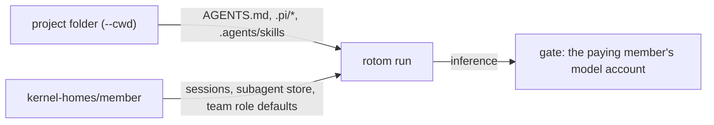

# Project configuration

This is the current configuration contract for new rotom sessions. Every member who works in a project gets the same
configuration: the project's. Model accounts stay personal: whoever sends still pays. The execution and safety
contract is [PRODUCT.md](PRODUCT.md); legacy frozen sessions keep their existing configuration.



## What loads

rotom starts every run with `--approve` (project trust). It reads, from the session's working folder:

| File                                      | What it is                                                     |
| ----------------------------------------- | -------------------------------------------------------------- |
| `AGENTS.md` (and those of parent folders) | Instructions                                                   |
| `.pi/SYSTEM.md`, `.pi/APPEND_SYSTEM.md`   | System prompt                                                  |
| `.pi/skills/`, `.agents/skills/`          | Skills                                                         |
| `.pi/mcp.json`                            | MCP servers                                                    |
| `.pi/extensions/`                         | Extensions (for example a recorder such as scry)               |
| `.pi/prompts/`                            | Prompt templates                                               |
| `.pi/settings.json`                       | Settings, except `packages` (below); sessions stay in the HOME |

Edit these files in the project. The next native startup reads them. The command menu is a separately scoped, short-lived discovery snapshot (below).

Pi reads `.pi/mcp.json`, not Claude Code's `.mcp.json`, and does not take the legacy SSE transport. A server that
serves streamable HTTP at the same URL needs only `{"url": …}` there.

In one folder Pi reads the first of `AGENTS.md` and `CLAUDE.md`, not both.

## rotom 0.1.21

The runtime pin is rotom 0.1.21 ([`runtime/rotom/pin.json`](../runtime/rotom/pin.json)). In 0.1.18 the Qoder legacy models
(`ultimate`, `qmodel_latest`, `smodel` and the other COSY routes) ran without the system prompt: rotom sent it only in a
top-level field that Qoder ignores. Such a run did not see `AGENTS.md`, `.pi/APPEND_SYSTEM.md`, the skill list or the
folder. 0.1.19 also sends it as the first message, as Qoder's own CLI does. Other models were not affected.

## Team subagent defaults

Every native kernel start, including frozen sessions, sets `subagents.agentOverrides` for `delegate`, `oracle`
(and its `advisor` alias), and `researcher` to `disabled: true` in the member's `.pi/agent/settings.json`.
The remaining builtins are `scout`, `worker`, and `reviewer`, whose bundled profiles declare explicit extensions
and fresh context. Disabled roles are absent from the executable list and cannot be selected for a new task.
Other settings and role fields are preserved; these defaults do not alter an already-running kernel or replay work.

These are team defaults, not an enforcement boundary. Native project overrides in `.pi/settings.json` take
precedence, and custom project agents are unchanged. A project override for one of these roles replaces its member
HOME override, so even an override that only sets a model can restore it. Restoring a role does not adapt it to scoped
execution: the native extension, context, tool and launch-mode checks still apply. No bundled dependency is modified.

## Native slash commands

Typing `/` uses the pinned runtime's builtin catalog, not Pocket's old hardcoded list. Dynamic extensions, prompt
templates and skills come from native `get_commands`. `GET /api/c/:id/prompts` reads a snapshot; it never starts project
code. Before discovery, it offers only builtins. **Load / refresh project commands on my account** explicitly starts
the trusted native runtime under the member's ordinary permissions, admission and lease. Discovery denies Team
inference and credential-refresh requests. It needs no paid prompt, but project startup is still trusted executable
code, not a sandbox. An idle session owned by another member is first handed over using public history.

Snapshots belong to one member, segment and immutable binding. Another member never receives their HOME-derived
descriptions. Idle snapshots expire after 30 seconds; settings changes invalidate them, and authorized startup/reload
captures them again. A snapshot is not a claim that project files have not changed since capture: refresh after editing
configuration. Dispatch validates the current native registry. Unknown names and private `team-kernel-*` commands do
not become model prompts. Native skills/templates are expanded by native APIs, including queued input. Selecting a
skill or prompt-template suggestion only fills the draft; submitting it starts the model request.

| Command                                                          | Team/native behavior                                                                                                                                                                                                                                                                   |
| ---------------------------------------------------------------- | -------------------------------------------------------------------------------------------------------------------------------------------------------------------------------------------------------------------------------------------------------------------------------------- |
| `/model`, `/thinking`, `/scoped-models`                          | Personal model picker and native model-pattern scope. A real Team handoff creates a new immutable binding; an active run is never mutated. Scope cycling uses that same path.                                                                                                          |
| `/name`                                                          | Native `set_session_name`, with confirmed readback mirrored into Team. Native defers JSONL creation before the first conversation; Team preserves the confirmed name and restores it on the next startup.                                                                              |
| `/new`, `/resume`                                                | Create a separate Team native conversation, or choose a visible existing one. No receipt is silently attached to a different native session.                                                                                                                                           |
| `/fork`                                                          | Select a native user-entry ID; create a Team-safe public-history seed **before** that user message. Restore its text as a draft, never submit it automatically. This is not a call to native `forkSession`.                                                                            |
| `/clone`                                                         | Native `createBranchedSession` for the same member; public-history seed for a different member.                                                                                                                                                                                        |
| `/tree`                                                          | Select an entry in the member's native segment. Native `ctx.navigateTree` changes the branch; optional **Summarize** (or `/tree <entryId> --summarize`) runs the native summarizer through the same payer/model gate. Persisted summary usage is recorded; absent usage stays unknown. |
| `/export`                                                        | Authenticated, member-private attachment using native JSONL branch serialization or the native HTML exporter. JSONL is the current branch, not a byte-for-byte full-tree copy. HTML retains the native exporter's tree behavior.                                                       |
| `/import`                                                        | Native parse/migration of a JSONL file in this workspace or this session's uploads, bounded to 50 MiB; a new Team conversation receives only public history, never imported provider state.                                                                                            |
| `/settings`                                                      | Native `SettingsManager` execution settings: steering/follow-up, image options, skill commands and model scope. Project settings take precedence; Team automatic retries/compaction remain disabled.                                                                                   |
| `/compact`, `/reload`, `/session`, `/copy`                       | Native compaction, resource reload, state/statistics and last-assistant-text clipboard result.                                                                                                                                                                                         |
| `/login`, `/logout`, `/hotkeys`, `/changelog`, `/trust`, `/quit` | Personal provider sheet, web shortcuts, pinned product update guidance, native project trust choices, and stopping/leaving this view respectively. Project trust does not create an OS boundary.                                                                                       |
| `/mcp`, `/mcp login <server>`, `/mcp logout <server>`            | The existing member-owned browserless sign-in bridge. These adapters first verify actual native registration.                                                                                                                                                                          |
| `/qoder-models`, `/qoder-credits`                                | The member's provider catalog/quota API in the credential-owning parent. Results are private HTTP responses, not room broadcasts. Account-changing/busy operations are refused; snapshots are not per-request debit or financial cost.                                                 |
| `/goal` and other registered extensions                          | Actual native handlers. Goal keeps its process, receipt, member and gate while active/waiting; native deadlines, Pause, Resume, Stop and plain input control that lifecycle.                                                                                                           |

**Only `/share` and `/bug` are explicitly excluded from this release.** They are absent from executable suggestions;
manual invocation is rejected before native startup, inference or upload. No sharing/auth service or diagnostic runner
is provided. Other commands may still refuse operations for permissions, an active/unknown lease, unavailable accounts
or invalid native inputs; these refusals are not simulated success.

### Branch interaction and outcomes

The pinned RPC `navigateTree` adapter returns only `cancelled`; it drops the native session's `editorText`, `aborted`
and summary result. Team therefore preserves native cancellation, extracts draft text with the pinned native
`contentText(content, "")` helper **after successful, non-no-op navigation**, and reads only newly persisted native
summary entries. The cancellation reason is unavailable, not inferred. String content and multiple text blocks use
native concatenation; image-only/empty entries are not offered by the fork selector. Cancellation, error and unknown
outcomes leave an existing draft untouched. Tree result readback is durable and does not replay navigation.

The shared transcript and the native snapshot API's `messages` are **immutable audit history**, including abandoned
branches. Navigation does not delete those records. A notice identifies this after branching; `/tree` labels active
versus abandoned branch entries. Native JSONL export follows the selected branch. Compaction may further reduce the
context sent to a model; branch membership is not a promise that every ancestor message is sent verbatim.

Native status/widget events replace or clear keyed live slots; only real `notify` events create notices. A `handled`
receipt means the handler completed, not that a requested navigation occurred: inspect its cancellation/result.
Side-effectful slash handlers use `command` receipts and are not automatically continued after unknown outcomes.
Only native-discovered prompt templates/skills become ordinary recoverable `prompt` operations. Existing stored
receipts stay readable and are not rewritten. Goal Stop may remain unknown; it does not certify external effects.

## What does not load

| Refused                                                                                                                   | Why                                                                                                                            |
| ------------------------------------------------------------------------------------------------------------------------- | ------------------------------------------------------------------------------------------------------------------------------ |
| Skills in a member's HOME: `.pi/agent/skills`, `.agents/skills`, and the `settings.json` `skills` key.                    | They may remain installed, but runs do not load them. Skills belong in the project.                                            |
| Other configuration in a member's HOME: instructions, MCP, extensions, prompts, themes, packages, or their settings keys. | A run refuses to start and names the resource, rather than applying private configuration to a shared project.                 |
| `packages` in `.pi/settings.json`.                                                                                        | They would install from the network at the start of each run. Put the extension in `.pi/extensions`. The run refuses to start. |

The **My instructions & skills** sheet and `rotom-team profile push` are gone. The menu keeps **My browser sign-ins**.

Pi Pocket's own extensions (Artifacts, Browser, Subagents, Scheduled messages, Done when, Plan mode, Lancet Guard,
Codemode, the system prompt) run in Pi Durable sessions only; a rotom run loads the project's `.pi/extensions` and its
own tools. So a server that starts sessions in rotom shows no **Extensions** page in Settings or the launcher, and a
rotom session's status line shows no guard state: those switches would look like they guarded rotom runs, and did not.

## MCP secrets

`.pi/mcp.json` usually lives in git. Do not write secrets in it. Read them from the server's keychain with a command
value; Pi runs it when the server connects:

```json
{
    "mcpServers": {
        "tools": {
            "command": "uvx",
            "args": ["tools-mcp"],
            "env": { "API_KEY": "!security find-generic-password -w -s tools-mcp" }
        }
    }
}
```

Store the secret once, as the service user: `security add-generic-password -s tools-mcp -a rotom-team -w`.
`${NAME}` still resolves against the run's scrubbed environment, so a server that names a service variable fails
closed. Everyone shares the server's identity with that service.

## MCP servers that use OAuth

An HTTP server in `.pi/mcp.json` without an `Authorization` header signs in with OAuth. The project declares it once;
**each member signs in with their own account**. The tokens go to that member's
`kernel-homes/<member>/.pi/agent/mcp-auth.json`, and only that member's runs send them. Another member's runs, a fork,
or a takeover use the sender's own sign-in.

```mermaid
sequenceDiagram
    participant M as Member's browser
    participant S as rotom-team server
    participant L as rotom mcp login (member HOME)
    participant A as OAuth server
    M->>S: MCP sign-ins → Sign in
    S->>L: start; it listens on 127.0.0.1:<port>/callback
    L-->>S: sign-in address
    S-->>M: link
    M->>A: open link, approve
    A-->>M: redirect to 127.0.0.1:<port>/callback?code=… (does not load)
    M->>S: paste that address → Finish
    S->>L: deliver it to that callback only
    L->>A: exchange code (PKCE), store tokens
```

Open it from the menu (**MCP sign-ins**) or with `/mcp` in a rotom session. The sheet lists the project's servers as
your runs reach them: connected, needs your sign-in, or failed. On the server's own computer the redirect loads by
itself; leave the address empty and press Finish.

- **The server never opens a browser.** Its browser is the service user's, and could approve as them. `rotom mcp` runs
  with a stand-in `open` (`src/server/no-browser/`), so the member always opens the link in their own browser.
- **A pasted address goes only to the open sign-in's callback**: same origin and path, or the server refuses it.
- **Who may:** members who can steer and may continue sessions in the project. The sheet starts the project's command
  servers to report them, as a run does.
- **The sheet records the project's trust** in the member's `trust.json` (`rotom mcp` has no `--approve`). Sessions
  with a frozen configuration start with `--no-approve`, so it does not open the project for them.
- **Backups:** restore leaves `mcp-auth.json` out, like `auth.json`. Members sign in again.
- A sign-in waits up to 10 minutes. Starting another one cancels it. A server restart ends it.

## Trust boundary changes

- **The project's extensions and MCP commands run on every member's run**, as the service user. They can read what the
  service user can read, and an extension can call a model provider of its own outside the gate. The
  "Trusted members only" boundary applies to the project's files: only trusted people should change them.
- **Sessions with a frozen configuration** (activated through the upstream configuration API) keep it, with no project
  trust: their pinned AGENTS.md and skills apply, not the project's `.pi`.

## Verification entry points

These opt-in proof scripts describe reproducible fixture assertions, not a claim about any untested release.
Check their inputs and authorization scope before running them; no real account or paid invocation is authorized by
this guide.

| Check               | Shows                                                                                                                                                                                                                                                                                                                                                                                                                           |
| ------------------- | ------------------------------------------------------------------------------------------------------------------------------------------------------------------------------------------------------------------------------------------------------------------------------------------------------------------------------------------------------------------------------------------------------------------------------- |
| `test:kernel`       | The project's MCP server (secret from `!printf`, standing in for the keychain), extension and skill load; personal skill directories remain installed but are not loaded; a `${SERVICE_VAR}` server fails closed; a member-HOME `mcp.json`, a member `settings.json` `extensions` key and project `packages` refuse the start.                                                                                                  |
| `test:kernel:app`   | Two members' runs in one project are both offered the project's MCP tool and see its skill. A member is offered the runtime's native command registry, including a skill from a `.pi/settings.json` path, and `/skill:name` reaches the model expanded; unknown slash names are rejected before inference.                                                                                                                      |
| `test:kernel:mcp`   | Against a loopback OAuth server: a member signs in through a pasted address; a foreign address is refused; no browser opens on the server; the other member still needs sign-in; the member's run connects with the member's token; sign-out works; a frozen session stays closed.                                                                                                                                              |
| `test:kernel:ui`    | In the browser: the MCP sheet lists the servers, signs the member in through the pasted address, then shows the server connected. Explicit discovery/authorized runs supply dynamic skills; `/mcp login` uses the member-owned sign-in sheet.                                                                                                                                                                                   |
| `test:kernel:qoder` | The transport fixture loads as a project extension for two members.                                                                                                                                                                                                                                                                                                                                                             |
| Negative control    | Without `--approve`, `test:kernel` fails on the project's MCP tool and `test:kernel:app` on the project's skill. Without the stand-in `open`, `test:kernel:mcp` records a browser opened on the server; without `--no-approve`, its frozen session loads the project's MCP. Treating all slash text as model prompts would allow an unknown command to reach inference; without the native registry route, the app proof fails. |

`node test/native-commands-proof.ts --ui` additionally checks the command adapters, branch/draft/summary interactions,
private downloads, private Qoder account results, unknown-command restart fencing and keyed status/widget UI.
`node test/rotom-goal-proof.ts` checks real native Goal timer, Stop, pause and wake against a loopback model.

The fixtures do not establish acceptance for a real keychain item (`!printf` stands in for it), a remote MCP or OAuth
server, servers requiring a Client ID Metadata Document or step-up scopes, or the mobile layout. Historical account
experiments and deployment evidence are not current verification and are kept outside this guide.
