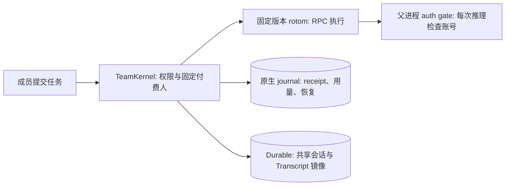

# rotom team 产品合同

当前包版本 `0.1.1`，以 [`package.json`](../package.json) 为准。共享会话历史，不共享模型账号。原生 macOS / 完全可信团队预览，不是多租户安全沙箱，也不宣称正式版验收完成。

## 当前执行路径

- 新会话默认由 rotom 执行。`--no-rotom-kernel` 启动仅使用 Pi Durable 的服务；既有 Durable 会话保持原后端，不自动迁移。
- rotom 版本及文件摘要由 [`runtime/rotom/pin.json`](../runtime/rotom/pin.json) 固定。团队包版本与 rotom 版本不是同一个版本号。
- Durable 只为 rotom 会话提供共享状态、权限和 Transcript 镜像，不另运行一个 Agent 循环。它自己的会话仍使用旧后端。
- rotom 的工具、扩展消息和问题进入同一 Transcript。只有本轮付费成员可以回答该轮交互问题。
- 可用 `--storage-worker` 将 journal 与公开 Durable Storage 放入单个数据库 worker，**默认关闭**；关闭时保持 D8a 路径。Harness、镜像协调、权限、个人凭据及 native/payer gate 仍在父线程。worker 失联不自动重启或重放；关闭必须先排空 native 所有权，再等数据库 ACK 和 worker 退出。失败保留租约。此开关仅用于 native kernel 模式，不删除旧后端能力，也不形成安全沙箱。

## 执行归属与历史

- 谁发送任务，使用谁的个人模型账号。空闲会话的下一位发送者接力；fork 使用发起人的账号。运行中付费人不变，不跨账号排队。
- 同一成员可在多个会话中同时运行，也可在自己有运行时接力其他会话；每个会话同一时间只有一个运行。登录、切换或登出模型账号要等该成员所有会话的运行结束或核清 unknown。
- 运行中的 steer/follow-up 属于当前付费成员。其他成员可以查看、评论、等待、停止后接力或 fork；项目 view/continue/fork 权限分别检查，fork 不扩大权限。
- 模型凭据由父进程保存和刷新。rotom 每次推理通过本轮 gate 获取授权；失效模型不回退管理员、环境变量或其他成员账号。未知刷新结果不重放。
- 跨账号历史投影仅包含公开文本及配对工具历史，不携带 thinking、签名、response ID 等私有 Provider 状态。原始记录不改写；这不是对可信协作者隐藏所有原始文件的 OS 访问控制。
- 子 Agent 通过同一父运行 gate 使用同一付费人和模型；其响应用量独立记录。父 gate 结束后，旧子 Agent 不能继续取得模型授权，也不会由新的父运行自动接管。

## 配置与工具

团队只有一个共享基础 Agent，配置分两层：Owner 管理 `<data>/team-agent` 的扩展、MCP、skills 和设置；可信项目提供原生设置、扩展、包、模板、主题、system 文件、上下文、skills 和 MCP；项目覆盖规则由原生加载器处理。成员 HOME 保留凭据、会话和未分类运行状态，不是可定制的个人资源配置。成员仍用自己的账号选择模型，固定付费人和模型绑定不变。完整规则与仍不支持的能力见 [CONFIGURATION.md](CONFIGURATION.md)。

- Team 只支持原生 Agent Extension。旧 `src/server/extensions/` 与 `<data>/extensions/` 不加载、不监听，旧服务扩展管理 API 不可用；历史文件和开关记录保留。全局与项目配置步骤见 [AGENT-CONFIGURATION.md](AGENT-CONFIGURATION.md)。
- 工作区按原生 `--approve` 加载。共享和项目扩展都以服务 OS 用户执行，必须信任代码，不是沙箱。项目角色和配置恢复原生加载；成员基础资源仍从共享配置派生。未知插件状态不猜测、不清空。
- 同一固定绑定的成功任务复用原生进程、MCP 连接和扩展内存；空闲时 gate 拒绝推理。失败、Stop、接力和服务关闭回收相应进程；跨重启恢复持久化会话，不恢复内存。资源/设置修改后执行 `/reload`。
- OAuth 型 MCP 由各成员在 **MCP sign-ins** 独立登录。MCP 授权与模型授权不同；文件分开不构成成员间 OS 隔离。
- 历史冻结配置会话保留原配置摘要，不自动切换为项目配置。相关配置 API 和 8 MiB 技能快照上限是旧会话路径，不是新会话的配置方式。
- rotom 使用服务用户的 Chrome Relay 和桌面；不同成员不拥有相互隔离的浏览器登录或屏幕。
- 未显式命名的会话在首条带正文的消息被原生 journal 接受后，以正文作为名称：合并空白、最多 80 个字符，不额外调用模型。后续消息和自动续跑不覆盖名称，拒绝入场的请求不占用名称；仅图片消息等待首条正文命名。不追溯已存在的无名会话历史。
- 会话列表用状态点提示“本轮已结束、当前成员尚未查看”。查看状态按成员独立保存并同步到该成员的浏览器；一个成员查看不会替其他成员清除提示。它只表示运行结束并产生了可查看结果，不证明任务或外部操作成功。

## 原生 slash 命令

- `/` 菜单来自固定版本的原生注册表。GET 只读；首次动态发现由成员明确启动，沿用权限和 lease，但拒绝 Team 模型推理。打开 slash 建议即显式发起发现。缓存按成员、segment 和固定绑定隔离，保留最后已知结果，不再空闲 30 秒后消失；显示 freshness，执行前仍核对原生注册表。未知命令不作为模型输入。
- 模型选择由 Team 授权：空闲时同成员在原生会话内切换，其他成员/内核变更仍接力；不改写已有回执绑定或运行中的付费人/模型。侧栏批量读取当前原生 head 的模型。原生 fork/tree 选择恢复编辑草稿，不自动提交；tree 的可选原生摘要使用当前成员和模型，记录真实持久化用量。共享 Transcript 是含废弃分支的审计历史，不等于当前模型上下文。
- 原生 JSONL 导出使用当前分支序列化；HTML 使用原生 exporter。原始导出只交付给该 segment 的成员。跨成员 fork/clone 仍只传公开历史。副本保留可见源标题并追加 `· Copy` / `· Fork`，导入历史不能覆盖新标题；项目文件夹共享，不复制文件。
- 原生扩展、技能和模板动态发现并默认准入，不维护第二份扩展白名单；终端账号、信任、上传、生命周期等受保护内置命令和私有 `team-kernel-*` 仍拒绝，原生命名优先级不能由同名模板绕过。目录增加 Web 能力/参数说明：`llama` 仅终端，已知无效 MCP 参数和裸 `subagents-stop` 明确拒绝；未知扩展标为未验证。闲时和排队执行均重新核对原生注册表及参数。内部生命周期操作和独立 Team API 不受菜单保护影响。
- Outputs 合并成功公开 write/edit 路径和已发布 Artifacts 的入口，仍走现有文件权限。它是历史引用，不是当前分支清单、文件快照或存在性保证；shell/未公开路径的产物使用项目文件面板，不扫描文件系统或挖掘私有嵌套参数。
- Tab 和部分名称回车只补全；完整命令回车才执行。thinking/fork 使用专用键盘选择器；settings 只有 owner 可写共享设置；裸 Goal 打开网页管理器，但不提供原生安全设置编辑器。这是保留 Team 边界的网页对齐，不是完整终端等价。
- `/browser` 和 `/computer-use` 指服务机器，而非访问页面的设备。`/mcp` 复用成员自己的浏览器外置登录桥。`/qoder-credits` 显示成员自己的额度快照，不广播，也不把未知值当作零或逐请求扣费。
- 5 个个人技能仍按用户选择不安装。子 Agent 指定技能、user/project memory 和已有项目 refinement 叠加使用原生实现。user memory 按付费成员私有路由，project memory 按项目共享；模型引用后仍可能出现在共享历史中。workflowScript 仍缺少原生 RPC 收尾接口，refinement 自动生成仍受原生前台执行限制。权限、账号和 unknown 不重放边界不变。详见 [CONFIGURATION.md](CONFIGURATION.md)。

## 中断、恢复与数据

- 干净停止只为尚在 execution 阶段的 prompt 记录续跑计划；原回执已 settled 后，重启才按计划以原成员继续一次。unknown 和旧 interrupted 一律不自动续接，PID 已消失或记录可读不能改变这一点。收尾前持久化 finalization 阶段，防止收尾时再安排续跑；超限失败和已有回复都不能把 unknown 改成成功。
- 连续 3 次普通 prompt 自动续跑后，下一次中断等待成员手动 **Continue**。副作用型原生命令使用 `command` receipt；unknown 后不按普通 prompt 自动续跑。只有原生注册表确认的 prompt template/skill 展开才保留普通 prompt 恢复行为。排队到普通 prompt 的副作用命令在发送前保存 durable 输入标记；只有确认 handled 才清除。未知输入使原 attempt 保持 unknown，禁止自动续跑，不改写其 operation。既有 receipt 不改写。仍可能存活的进程、unknown 操作、未核清 lease 不自动重放；compaction、handoff、fork 和 discovery 的中断需要对账。
- Stop 请求、PID 消失、旧 PASS 或 receipt 存在，单独都不能证明工具已关闭或业务成功。操作步骤见 [NATIVE-RECOVERY.md](NATIVE-RECOVERY.md)。
- 离线备份含秘密，要求停止 writer、核清 lease，并验证逐文件摘要。恢复只能使用原绝对路径且不能覆盖现有目录；模型和 MCP refresh grants 不恢复，须独立重登。项目工作区另行备份。

## 信任边界与限制

- 原生工具具有服务 OS 用户的文件权限，可能读取其他成员的凭据。独立文件、`0700/0600`、worktree 和项目权限都不是 OS 沙箱。使用专用系统账号，只邀请完全可信成员。
- 默认仅监听 loopback。HTTPS、SSH 转发或其他远程入口由部署者明确配置；不直接暴露给不信任的人。远程 OpenAI 登录规则见 [REMOTE-OPENAI-LOGIN.md](REMOTE-OPENAI-LOGIN.md)。
- rotom 会话支持上传文件，以及在输入框中粘贴、拖入图片；支持图片的模型直接接收压缩后的图片输入，其他附件以该会话可读的上传路径交给 Agent。单个上传仍受 50 MiB 限制，直接送入模型的图片最多 5 MiB/张、20 MiB/条消息。美元预算仍不可证明，设置 USD 预算时拒绝执行。Token、API 成本估计、订阅额度、Qoder credits 与财务账单不同；缺失保持 unknown，不用零费用占位。
- Qoder 在历史已耗尽已验证上下文窗口时拒绝推理，并提示显式压缩历史或选择更大窗口的模型；不得把剩余输出预算静默压成一个 token 后发送。
- thinking 不进入公共镜像；运行结果和跨账号投影有意不是逐字无损。旧子 Agent 的恢复、跨机器活跃 SQLite 迁移、个人执行节点、SSO 和多租户隔离不是已交付能力。
- rotom 运行由其固定产品合同约束；不能把 Durable 的定时任务、Goal、预算页或扩展说明直接套到 rotom 会话。配置加载及原生 UI 边界见 [CONFIGURATION.md](CONFIGURATION.md)。
- Qoder adapter 是非官方代码；目录、额度或登录成功不证明服务商许可、完整结算或团队托管批准。正式 SIWC 注册/品牌、服务商支持与分发授权见 [PROVIDER-POLICY.md](PROVIDER-POLICY.md)。

## 当前文档入口

[README](../README.md) 提供启动和使用方式；[CONFIGURATION.md](CONFIGURATION.md) 提供共享基础 Agent / 项目双层配置合同；[VERIFICATION.md](VERIFICATION.md) 说明验证范围；[NATIVE-DELIVERY.md](NATIVE-DELIVERY.md) 保留 R1–R8 验收要求；[DELIVERY-CHECKLIST.md](DELIVERY-CHECKLIST.md) 列出正式交付检查；[DEPLOYMENT.md](DEPLOYMENT.md) 与 [NATIVE-RECOVERY.md](NATIVE-RECOVERY.md) 提供运维边界。

旧迁移计划、阶段合同和实验验收记录不作为当前产品依据；需要追溯时从 Git 历史查看。私有账号、部署记录和原始日志不进入仓库。代码级检查不替代真实账号、目标设备或正式版验收。
