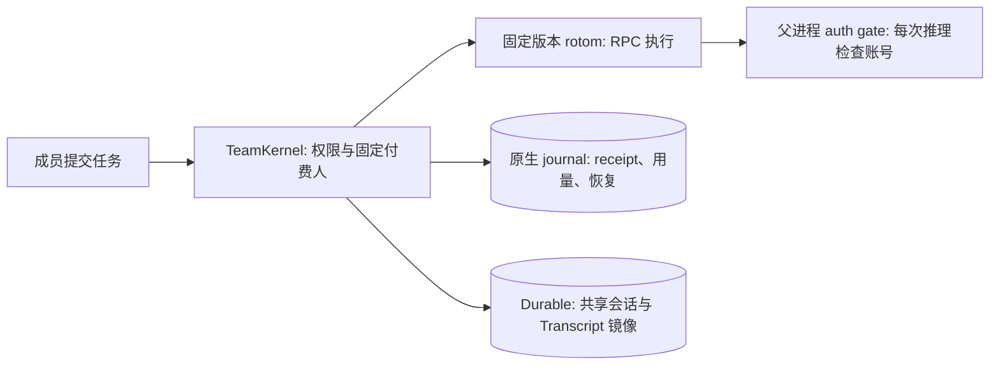

# rotom team 产品合同

当前包版本 `0.1.1`，以 [`package.json`](../package.json) 为准。共享会话历史，不共享模型账号。原生 macOS / 完全可信团队预览，不是多租户安全沙箱，也不宣称正式版验收完成。

## 当前执行路径

- 新会话默认由 rotom 执行。`--no-rotom-kernel` 启动仅使用 Pi Durable 的服务；既有 Durable 会话保持原后端，不自动迁移。
- rotom 版本及文件摘要由 [`runtime/rotom/pin.json`](../runtime/rotom/pin.json) 固定。团队包版本与 rotom 版本不是同一个版本号。
- Durable 只为 rotom 会话提供共享状态、权限和 Transcript 镜像，不另运行一个 Agent 循环。它自己的会话仍使用旧后端。
- rotom 的工具、扩展消息和问题进入同一 Transcript。只有本轮付费成员可以回答该轮交互问题。

## 执行归属与历史

- 谁发送任务，使用谁的个人模型账号。空闲会话的下一位发送者接力；fork 使用发起人的账号。运行中付费人不变，不跨账号排队。
- 同一成员可在多个会话中同时运行，也可在自己有运行时接力其他会话；每个会话同一时间只有一个运行。登录、切换或登出模型账号要等该成员所有会话的运行结束或核清 unknown。
- 运行中的 steer/follow-up 属于当前付费成员。其他成员可以查看、评论、等待、停止后接力或 fork；项目 view/continue/fork 权限分别检查，fork 不扩大权限。
- 模型凭据由父进程保存和刷新。rotom 每次推理通过本轮 gate 获取授权；失效模型不回退管理员、环境变量或其他成员账号。未知刷新结果不重放。
- 跨账号历史投影仅包含公开文本及配对工具历史，不携带 thinking、签名、response ID 等私有 Provider 状态。原始记录不改写；这不是对可信协作者隐藏所有原始文件的 OS 访问控制。
- 子 Agent 通过同一父运行 gate 使用同一付费人和模型；其响应用量独立记录。父 gate 结束后，旧子 Agent 不能继续取得模型授权，也不会由新的父运行自动接管。

## 配置与工具

新会话每次运行读取项目的 `AGENTS.md`、skills、MCP 和扩展，不再使用个人配置层。成员 HOME 中已安装的 skills 可以保留，但默认不加载，也不阻塞运行。完整加载、信任及 MCP 登录规则见 [CONFIGURATION.md](CONFIGURATION.md)。

- 项目文件由所有成员共享；项目 MCP 命令和扩展以服务 OS 用户执行，只允许可信人员修改这些文件。
- OAuth 型 MCP 由各成员在 **MCP sign-ins** 独立登录。MCP 授权与模型授权不同；文件分开不构成成员间 OS 隔离。
- 历史冻结配置会话保留原配置摘要，不自动切换为项目配置。相关配置 API 和 8 MiB 技能快照上限是旧会话路径，不是新会话的配置方式。
- rotom 使用服务用户的 Chrome Relay 和桌面；不同成员不拥有相互隔离的浏览器登录或屏幕。
- 未显式命名的会话在首条带正文的消息被原生 journal 接受后，以正文作为名称：合并空白、最多 80 个字符，不额外调用模型。后续消息和自动续跑不覆盖名称，拒绝入场的请求不占用名称；仅图片消息等待首条正文命名。不追溯已存在的无名会话历史。
- 会话列表用状态点提示“本轮已结束、当前成员尚未查看”。查看状态按成员独立保存并同步到该成员的浏览器；一个成员查看不会替其他成员清除提示。它只表示运行结束并产生了可查看结果，不证明任务或外部操作成功。

## 中断、恢复与数据

- 干净停止为运行中的 prompt 记录续跑计划；重启后以原成员继续一次。崩溃后只有确认旧 rotom 进程已结束，才能将 prompt 标为 interrupted 并安排继续。
- 连续 3 次自动续跑后，下一次中断等待成员手动 **Continue**。仍可能存活的进程、unknown 操作、未核清 lease 不自动重放；compaction、handoff 和 fork 的中断需要对账。
- Stop 请求、PID 消失、旧 PASS 或 receipt 存在，单独都不能证明工具已关闭或业务成功。操作步骤见 [NATIVE-RECOVERY.md](NATIVE-RECOVERY.md)。
- 离线备份含秘密，要求停止 writer、核清 lease，并验证逐文件摘要。恢复只能使用原绝对路径且不能覆盖现有目录；模型和 MCP refresh grants 不恢复，须独立重登。项目工作区另行备份。

## 信任边界与限制

- 原生工具具有服务 OS 用户的文件权限，可能读取其他成员的凭据。独立文件、`0700/0600`、worktree 和项目权限都不是 OS 沙箱。使用专用系统账号，只邀请完全可信成员。
- 默认仅监听 loopback。HTTPS、SSH 转发或其他远程入口由部署者明确配置；不直接暴露给不信任的人。远程 OpenAI 登录规则见 [REMOTE-OPENAI-LOGIN.md](REMOTE-OPENAI-LOGIN.md)。
- rotom 会话支持上传文件，以及在输入框中粘贴、拖入图片；支持图片的模型直接接收压缩后的图片输入，其他附件以该会话可读的上传路径交给 Agent。单个上传仍受 50 MiB 限制，直接送入模型的图片最多 5 MiB/张、20 MiB/条消息。美元预算仍不可证明，设置 USD 预算时拒绝执行。Token、API 成本估计、订阅额度、Qoder credits 与财务账单不同；缺失保持 unknown，不用零费用占位。
- Qoder 在历史已耗尽已验证上下文窗口时拒绝推理，并提示显式压缩历史或选择更大窗口的模型；不得把剩余输出预算静默压成一个 token 后发送。
- thinking 不进入公共镜像；运行结果和跨账号投影有意不是逐字无损。旧子 Agent 的恢复、跨机器活跃 SQLite 迁移、个人执行节点、SSO 和多租户隔离不是已交付能力。
- rotom 运行由其固定产品合同约束；不能把 Durable 的定时任务、Goal、预算页或扩展说明直接套到 rotom 会话。配置加载及原生 UI 边界见 [CONFIGURATION.md](CONFIGURATION.md)。
- Qoder adapter 是非官方代码；目录、额度或登录成功不证明服务商许可、完整结算或团队托管批准。正式 SIWC 注册/品牌、服务商支持与分发授权见 [PROVIDER-POLICY.md](PROVIDER-POLICY.md)。

## 当前文档入口

[README](../README.md) 提供启动和使用方式；[CONFIGURATION.md](CONFIGURATION.md) 提供当前项目配置合同；[VERIFICATION.md](VERIFICATION.md) 说明验证范围；[NATIVE-DELIVERY.md](NATIVE-DELIVERY.md) 保留 R1–R8 验收要求；[DELIVERY-CHECKLIST.md](DELIVERY-CHECKLIST.md) 列出正式交付检查；[DEPLOYMENT.md](DEPLOYMENT.md) 与 [NATIVE-RECOVERY.md](NATIVE-RECOVERY.md) 提供运维边界。

旧迁移计划、阶段合同和实验验收记录不作为当前产品依据；需要追溯时从 Git 历史查看。私有账号、部署记录和原始日志不进入仓库。代码级检查不替代真实账号、目标设备或正式版验收。
