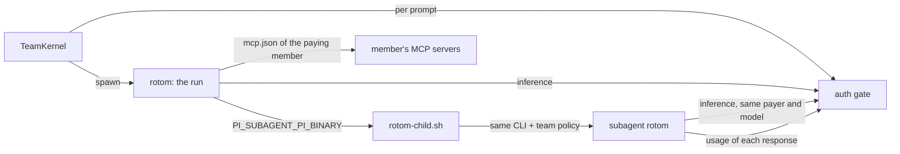

# rotom-team v1.1 (0.1.1)

v1.1 builds on [v1](V1.md). It pins rotom 0.1.18, gives each member their own MCP servers, and lets Pi start subagents in
team sessions. Everything in v1 still holds: rotom executes, whoever sends pays, and credentials stay in the parent.

> [v1.2](V1.2.md) replaces personal MCP servers with the project's `.pi/mcp.json`. The MCP rows below describe 0.1.1.

## What v1.1 adds

| Need                      | How v1.1 does it                                                                                                                                                                                                                                                           | Evidence                                                                                                                           |
| ------------------------- | -------------------------------------------------------------------------------------------------------------------------------------------------------------------------------------------------------------------------------------------------------------------------- | ---------------------------------------------------------------------------------------------------------------------------------- |
| rotom 0.1.18              | [`runtime/rotom/pin.json`](../runtime/rotom/pin.json) pins `@bingjiang0611/rotom@0.1.18` (bundled Pi 1.1.0-rotom.2, built-in MCP) by version and sha256. The in-process Pi/Durable stays at 1.0.2.                                                                         | `npm run check-kernel`; all `test:kernel*`                                                                                         |
| Personal MCP servers      | Each member writes their own `mcp.json` under **My instructions & skills**, or pushes it with `rotom-team profile push`. rotom's built-in MCP reads it from the paying member's layer. The server checks it is JSON with an `mcpServers` object before it writes anything. | `test:kernel` (`personalMcp`: the server is offered and called); `test:kernel:app` (only Bob's runs offer Bob's server; bad → 400) |
| Project MCP stays closed  | A project's `.pi/mcp.json` does not load: project trust is never granted.                                                                                                                                                                                                  | `test:kernel` (`projectMcpLoaded: false`)                                                                                          |
| No service secrets to MCP | `${NAME}` in `mcp.json` resolves against the run's scrubbed environment. A server that names a service secret fails closed.                                                                                                                                                | `test:kernel` (`serviceEnvMcpLoaded: false`)                                                                                       |
| Subagents                 | pi-subagents starts each child through [`rotom-child.sh`](../src/server/rotom-child.sh): the parent's verified rotom CLI plus the team policy. The child asks the parent run's gate for every inference, as the same member and model. Its HOME holds no grant.            | `test:kernel:app` (`subagentsThroughTheGate`: the child reached the model once, as the sender; `auth.json` is `{}`)                |
| The run waits for them    | Children run in the background. The run ends when their results are back, and Pi's turn on them ran, on the same payer and gate. While it waits, the Transcript shows "Pi is waiting for a subagent".                                                                      | `test:kernel:app`; `npm run demo:kernel`; checked in a real browser                                                                |
| Stop ends them            | **Stop** ends the turn and stops the run's children.                                                                                                                                                                                                                       | `test:kernel:app` (`stopEndsSubagents`: children `complete`, `stopped`)                                                            |
| Child usage is metered    | Each child response reports its usage to the gate. The journal records it for the run's member (`kernel_child_usage`, journal v4) and shows it with `subagent: true` in the session's usage.                                                                               | `test:kernel:app`; `rotom-journal.test.ts`                                                                                         |
| Failures show             | Like Pi, the Transcript shows extension messages that Pi marks for display. pi-subagents marks a failed or stopped background child; a completed one stays hidden, and Pi's own reply carries its result.                                                                  | `projection.test.ts`                                                                                                               |

## Trust boundary changes

- **MCP tokens are readable by other members' runs.** Every run uses the same OS user, so a token written in
  `mcp.json` is readable by any member's run. This is the v1 rule "Trusted members only", applied to MCP.
- **MCP commands run on the server** as the service user, like every other tool.
- **Subagents use no new credential path.** A child gets the parent run's gate address and token through its
  environment. The gate accepts it only while that run is active, only for the run's provider and model.

## Limits of v1.1

| Limit                                                                                                                                      | Why                                                                                     | When to lift it                                                             |
| ------------------------------------------------------------------------------------------------------------------------------------------ | --------------------------------------------------------------------------------------- | --------------------------------------------------------------------------- |
| Sign-in (OAuth) MCP servers are not supported; `mcp-auth.json` is not pushed.                                                              | A refresh rotates the token: the server's copy and the member's local copy would fight. | When the parent can own MCP sign-ins like it owns model credentials.        |
| Project `.pi/mcp.json` is not loaded.                                                                                                      | It would run project-chosen commands on every member's run.                             | When a project trust decision exists (rotom offers `pi.registerMcpServer`). |
| A subagent runs on the parent's model.                                                                                                     | The gate allows only the run's provider and model.                                      | When per-child model choice needs its own payer rule.                       |
| Qoder credits of children are not counted.                                                                                                 | Only the usage that Pi reports per response is recorded.                                | When Qoder reports credits per response.                                    |
| A server restart does not resume children. The parent prompt resumes as in v1; its old children cannot reach a model (their gate is gone). | Children are separate processes; their gate closes with the run.                        | When pi-subagents can hand a running child over to a new parent process.    |
| Long data paths log "Background-work snapshot sessionId must be at most 256 characters."                                                   | pi-subagents caps that id. It only skips a status snapshot.                             | Use a shorter `--data` path if the warning is noisy.                        |
| Depends on rotom internals: the pi-subagents store layout, its event names, `PI_SUBAGENT_PI_BINARY`.                                       | No public rotom contract for these yet.                                                 | Re-run `test:kernel:app` on every rotom pin change; it fails if these move. |

## Verification of 0.1.1

All checks use synthetic accounts and loopback scripted models. **No real model account was used.**

| Check                                                        | Result                                                                                                                                                                                                                                                                                                                                |
| ------------------------------------------------------------ | ------------------------------------------------------------------------------------------------------------------------------------------------------------------------------------------------------------------------------------------------------------------------------------------------------------------------------------- |
| `npm run check`, `npm run lint`, `prettier --check`          | pass                                                                                                                                                                                                                                                                                                                                  |
| `npm test`                                                   | 329/329                                                                                                                                                                                                                                                                                                                               |
| `test:kernel`, `:proxy`, `:history`, `:qoder`, `:app`, `:ui` | pass                                                                                                                                                                                                                                                                                                                                  |
| `npm run demo:kernel`                                        | pass (includes a subagent review: 5 model calls, all on the sender)                                                                                                                                                                                                                                                                   |
| Negative controls                                            | MCP owner set to nobody → the app proof times out. Without the children report → "the child reached the model once" fails. Old abort (turn only) → the stop proof hangs. Without the child usage report → "the child's response is charged to the same member" fails. Showing hidden extension messages → `projection.test.ts` fails. |
| Real browser (Chrome, loopback demo)                         | The waiting banner shows while the child runs and clears when the run ends; the MCP field shows its note, and a save error shows next to **Save**.                                                                                                                                                                                    |

Not verified: real ChatGPT/Qoder accounts with MCP or subagents, a real MCP server over HTTP, children across a real
crash of the whole host, mobile layouts of the new banner, deployment on the spare machine.
