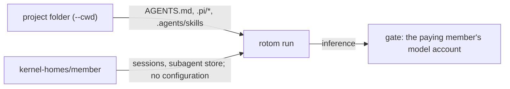

# rotom-team v1.2: configuration belongs to the project

v1.2 replaces the personal layer of [v1](V1.md) and [v1.1](V1.1.md). Every member who works in a project gets the same
configuration: the project's. Model accounts stay personal: whoever sends still pays.



## What loads

rotom starts every run with `--approve` (project trust). It reads, from the session's working folder:

| File                                      | What it is                                                     |
| ----------------------------------------- | -------------------------------------------------------------- |
| `AGENTS.md` (and those of parent folders) | Instructions                                                   |
| `.pi/SYSTEM.md`, `.pi/APPEND_SYSTEM.md`   | System prompt                                                  |
| `.pi/skills/`, `.agents/skills/`          | Skills                                                         |
| `.pi/mcp.json`                            | MCP servers                                                    |
| `.pi/extensions/`                         | Extensions (for example a recorder such as scry)               |
| `.pi/prompts/`                            | Prompt templates                                               |
| `.pi/settings.json`                       | Settings, except `packages` (below); sessions stay in the HOME |

Edit these files in the project. The next run reads them; nothing is cached.

## What does not load

| Refused                                                                                                                       | Why                                                                                                                            |
| ----------------------------------------------------------------------------------------------------------------------------- | ------------------------------------------------------------------------------------------------------------------------------ |
| Anything in a member's HOME: `.pi/agent/{AGENTS.md,SYSTEM.md,mcp.json,extensions,skills,prompts,themes,…}`, `.agents/skills`. | Configuration is the project's. A run whose HOME holds one refuses to start and names the file, instead of applying it.        |
| `settings.json` resource keys in a member's HOME (`extensions`, `skills`, `prompts`, `themes`, `packages`).                   | Same.                                                                                                                          |
| `packages` in `.pi/settings.json`.                                                                                            | They would install from the network at the start of each run. Put the extension in `.pi/extensions`. The run refuses to start. |

The **My instructions & skills** sheet and `rotom-team profile push` are gone. The menu keeps **My browser sign-ins**.

## MCP secrets

`.pi/mcp.json` usually lives in git. Do not write secrets in it. Read them from the server's keychain with a command
value; Pi runs it when the server connects:

```json
{
    "mcpServers": {
        "tools": {
            "command": "uvx",
            "args": ["tools-mcp"],
            "env": { "API_KEY": "!security find-generic-password -w -s tools-mcp" }
        }
    }
}
```

Store the secret once, as the service user: `security add-generic-password -s tools-mcp -a rotom-team -w`.
`${NAME}` still resolves against the run's scrubbed environment, so a server that names a service variable fails
closed. Everyone shares the server's identity with that service.

## Trust boundary changes

- **The project's extensions and MCP commands run on every member's run**, as the service user. They can read what the
  service user can read, and an extension can call a model provider of its own outside the gate. This is v1's
  "Trusted members only", applied to the project's files: only trusted people should change them.
- **Sessions with a frozen configuration** (activated through the upstream configuration API) keep it, with no project
  trust: their pinned AGENTS.md and skills apply, not the project's `.pi`.

## Verification

| Check               | Shows                                                                                                                                                                                                                                                          |
| ------------------- | -------------------------------------------------------------------------------------------------------------------------------------------------------------------------------------------------------------------------------------------------------------- |
| `test:kernel`       | The project's MCP server (secret from `!printf`, standing in for the keychain), extension and skill load; a `${SERVICE_VAR}` server fails closed; a member-HOME `mcp.json`, a member `settings.json` `extensions` key and project `packages` refuse the start. |
| `test:kernel:app`   | Two members' runs in one project are both offered the project's MCP tool and see its skill.                                                                                                                                                                    |
| `test:kernel:qoder` | The transport fixture loads as a project extension for two members.                                                                                                                                                                                            |
| Negative control    | Without `--approve`, `test:kernel` fails on the project's MCP tool and `test:kernel:app` on the project's skill.                                                                                                                                               |

Not verified: a real keychain item (the proof uses `!printf`), a real remote MCP server.
