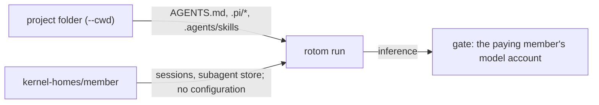

# rotom-team v1.2: configuration belongs to the project

v1.2 replaces the personal layer of [v1](V1.md) and [v1.1](V1.1.md). Every member who works in a project gets the same
configuration: the project's. Model accounts stay personal: whoever sends still pays.



## What loads

rotom starts every run with `--approve` (project trust). It reads, from the session's working folder:

| File                                      | What it is                                                     |
| ----------------------------------------- | -------------------------------------------------------------- |
| `AGENTS.md` (and those of parent folders) | Instructions                                                   |
| `.pi/SYSTEM.md`, `.pi/APPEND_SYSTEM.md`   | System prompt                                                  |
| `.pi/skills/`, `.agents/skills/`          | Skills                                                         |
| `.pi/mcp.json`                            | MCP servers                                                    |
| `.pi/extensions/`                         | Extensions (for example a recorder such as scry)               |
| `.pi/prompts/`                            | Prompt templates                                               |
| `.pi/settings.json`                       | Settings, except `packages` (below); sessions stay in the HOME |

Edit these files in the project. The next run reads them; nothing is cached.

Pi reads `.pi/mcp.json`, not Claude Code's `.mcp.json`, and does not take the legacy SSE transport. A server that
serves streamable HTTP at the same URL needs only `{"url": …}` there.

In one folder Pi reads the first of `AGENTS.md` and `CLAUDE.md`, not both.

## rotom 0.1.19

v1.2 pins rotom 0.1.19 ([`runtime/rotom/pin.json`](../runtime/rotom/pin.json)). In 0.1.18 the Qoder legacy models
(`ultimate`, `qmodel_latest`, `smodel` and the other COSY routes) ran without the system prompt: rotom sent it only in a
top-level field that Qoder ignores. Such a run did not see `AGENTS.md`, `.pi/APPEND_SYSTEM.md`, the skill list or the
folder. 0.1.19 also sends it as the first message, as Qoder's own CLI does. Other models were not affected.

## Running a skill by name

Type `/skill:` in the message box: it offers the project's skills. `/skill:name what to do` sends the skill's
instructions with the request; the kernel expands it, as rotom does. Other slash commands (`/mcp`, `/compact`, …) are
still refused: they would run in the kernel outside the run's journal. Prompt templates are not offered or sent, since
their names can clash with those commands.

The list is computed on the server from `.pi/skills`, the `skills` paths in `.pi/settings.json` (relative to `.pi`),
and `.agents/skills` up to the repository root. It leaves out rotom's bundled skills (`pi-subagents`) and skills
that extensions add; those still run when typed.

## What does not load

| Refused                                                                                                                       | Why                                                                                                                            |
| ----------------------------------------------------------------------------------------------------------------------------- | ------------------------------------------------------------------------------------------------------------------------------ |
| Anything in a member's HOME: `.pi/agent/{AGENTS.md,SYSTEM.md,mcp.json,extensions,skills,prompts,themes,…}`, `.agents/skills`. | Configuration is the project's. A run whose HOME holds one refuses to start and names the file, instead of applying it.        |
| `settings.json` resource keys in a member's HOME (`extensions`, `skills`, `prompts`, `themes`, `packages`).                   | Same.                                                                                                                          |
| `packages` in `.pi/settings.json`.                                                                                            | They would install from the network at the start of each run. Put the extension in `.pi/extensions`. The run refuses to start. |

The **My instructions & skills** sheet and `rotom-team profile push` are gone. The menu keeps **My browser sign-ins**.

Pi Pocket's own extensions (Artifacts, Browser, Subagents, Scheduled messages, Done when, Plan mode, Lancet Guard,
Codemode, the system prompt) run in Pi Durable sessions only; a rotom run loads the project's `.pi/extensions` and its
own tools. So a server that starts sessions in rotom shows no **Extensions** page in Settings or the launcher, and a
rotom session's status line shows no guard state: those switches would look like they guarded rotom runs, and did not.

## MCP secrets

`.pi/mcp.json` usually lives in git. Do not write secrets in it. Read them from the server's keychain with a command
value; Pi runs it when the server connects:

```json
{
    "mcpServers": {
        "tools": {
            "command": "uvx",
            "args": ["tools-mcp"],
            "env": { "API_KEY": "!security find-generic-password -w -s tools-mcp" }
        }
    }
}
```

Store the secret once, as the service user: `security add-generic-password -s tools-mcp -a rotom-team -w`.
`${NAME}` still resolves against the run's scrubbed environment, so a server that names a service variable fails
closed. Everyone shares the server's identity with that service.

## MCP servers that use OAuth

An HTTP server in `.pi/mcp.json` without an `Authorization` header signs in with OAuth. The project declares it once;
**each member signs in with their own account**. The tokens go to that member's
`kernel-homes/<member>/.pi/agent/mcp-auth.json`, and only that member's runs send them. Another member's runs, a fork,
or a takeover use the sender's own sign-in.

```mermaid
sequenceDiagram
    participant M as Member's browser
    participant S as rotom-team server
    participant L as rotom mcp login (member HOME)
    participant A as OAuth server
    M->>S: MCP sign-ins → Sign in
    S->>L: start; it listens on 127.0.0.1:<port>/callback
    L-->>S: sign-in address
    S-->>M: link
    M->>A: open link, approve
    A-->>M: redirect to 127.0.0.1:<port>/callback?code=… (does not load)
    M->>S: paste that address → Finish
    S->>L: deliver it to that callback only
    L->>A: exchange code (PKCE), store tokens
```

Open it from the menu (**MCP sign-ins**) or with `/mcp` in a rotom session. The sheet lists the project's servers as
your runs reach them: connected, needs your sign-in, or failed. On the server's own computer the redirect loads by
itself; leave the address empty and press Finish.

- **The server never opens a browser.** Its browser is the service user's, and could approve as them. `rotom mcp` runs
  with a stand-in `open` (`src/server/no-browser/`), so the member always opens the link in their own browser.
- **A pasted address goes only to the open sign-in's callback**: same origin and path, or the server refuses it.
- **Who may:** members who can steer and may continue sessions in the project. The sheet starts the project's command
  servers to report them, as a run does.
- **The sheet records the project's trust** in the member's `trust.json` (`rotom mcp` has no `--approve`). Sessions
  with a frozen configuration start with `--no-approve`, so it does not open the project for them.
- **Backups:** restore leaves `mcp-auth.json` out, like `auth.json`. Members sign in again.
- A sign-in waits up to 10 minutes. Starting another one cancels it. A server restart ends it.

## Trust boundary changes

- **The project's extensions and MCP commands run on every member's run**, as the service user. They can read what the
  service user can read, and an extension can call a model provider of its own outside the gate. This is v1's
  "Trusted members only", applied to the project's files: only trusted people should change them.
- **Sessions with a frozen configuration** (activated through the upstream configuration API) keep it, with no project
  trust: their pinned AGENTS.md and skills apply, not the project's `.pi`.

## Verification

| Check               | Shows                                                                                                                                                                                                                                                                                                                                                                                              |
| ------------------- | -------------------------------------------------------------------------------------------------------------------------------------------------------------------------------------------------------------------------------------------------------------------------------------------------------------------------------------------------------------------------------------------------- |
| `test:kernel`       | The project's MCP server (secret from `!printf`, standing in for the keychain), extension and skill load; a `${SERVICE_VAR}` server fails closed; a member-HOME `mcp.json`, a member `settings.json` `extensions` key and project `packages` refuse the start.                                                                                                                                     |
| `test:kernel:app`   | Two members' runs in one project are both offered the project's MCP tool and see its skill. A member is offered the project's skills, including one from a `.pi/settings.json` path, and `/skill:name` reaches the model expanded; `/mcp` is refused.                                                                                                                                              |
| `test:kernel:mcp`   | Against a loopback OAuth server: a member signs in through a pasted address; a foreign address is refused; no browser opens on the server; the other member still needs sign-in; the member's run connects with the member's token; sign-out works; a frozen session stays closed.                                                                                                                 |
| `test:kernel:ui`    | In the browser: the MCP sheet lists the servers, signs the member in through the pasted address, then shows the server connected. Typing `/skill:` lists the project's skills.                                                                                                                                                                                                                     |
| `test:kernel:qoder` | The transport fixture loads as a project extension for two members.                                                                                                                                                                                                                                                                                                                                |
| Negative control    | Without `--approve`, `test:kernel` fails on the project's MCP tool and `test:kernel:app` on the project's skill. Without the stand-in `open`, `test:kernel:mcp` records a browser opened on the server; without `--no-approve`, its frozen session loads the project's MCP. Refusing every slash text fails the `/skill:` run with 400; without the rotom route for the list, the app proof fails. |

On a real Qoder account in rate-native with `ultimate`, asked not to use tools: on 0.1.18 the run had 4592 input tokens
and found none of the facts that exist only in the system prompt (CLAUDE.md, the skill list, the folder); on 0.1.19 it
had 20321 and answered all four.

Not verified: a real keychain item (the proof uses `!printf`), a real remote MCP or OAuth server (the proofs use
loopback fixtures), servers that need a Client ID Metadata Document or step-up scopes, and the mobile layout of the
sheet.
