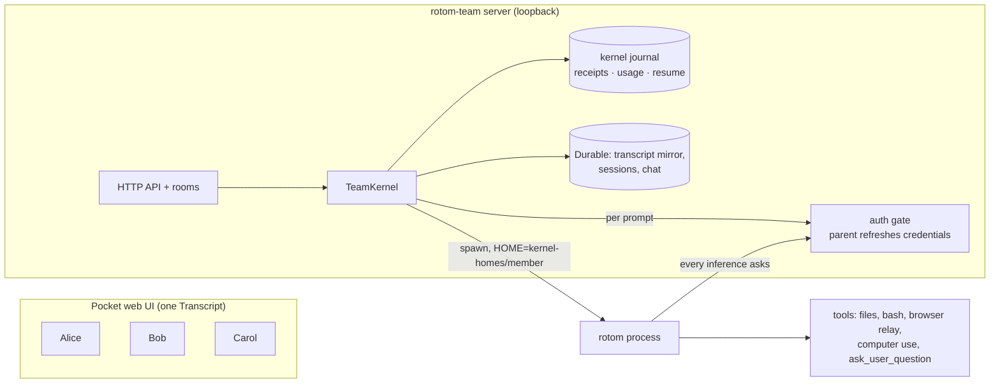

# rotom-team v1 (0.1.0)

v1 makes rotom the execution engine of a shared team workspace. rotom (`@bingjiang0611/rotom`, pinned in
[`runtime/rotom/pin.json`](../runtime/rotom/pin.json)) runs every new session. The team layer (Pi Pocket + Pi Durable)
keeps the shared state, the one web UI, permissions, accounts and recovery. It does not run an agent loop of its own for
rotom sessions.



## What v1 does

| Need                             | How v1 does it                                                                                                                                                                                                                                                                                                                 | Evidence                                                                                                                     |
| -------------------------------- | ------------------------------------------------------------------------------------------------------------------------------------------------------------------------------------------------------------------------------------------------------------------------------------------------------------------------------ | ---------------------------------------------------------------------------------------------------------------------------- |
| rotom executes                   | Each prompt starts the pinned rotom in RPC mode, with its whole tool surface (browser relay, computer use, codemode, `ask_user_question`, `search_tools`). Durable only mirrors the session file.                                                                                                                              | `test:kernel` (tools offered, write/read, real `browser_inspect` reply); `test:kernel:app` (`noDurableFallback`)             |
| One UI                           | The Pocket Transcript renders rotom sessions: live text and tool calls while Pi works, mirrored history after. Durable-only menu items are hidden.                                                                                                                                                                             | `test:kernel:ui` (screenshots of streaming, menu, question)                                                                  |
| Everyone pays for themselves     | Whoever sends a message pays. Sending in someone else's idle session takes it over on your account. A fork runs on the forker's account. Mid-run messages (steer/follow-up) are only for the member paying for the run.                                                                                                        | `test:kernel:app` (`submitTakesOverWithSendersAccount`, `fixedPayer`, `messagesJoinTheRunningPrompt`); `npm run demo:kernel` |
| Project configuration            | Superseded in [v1.2](V1.2.md): every run loads the project's `AGENTS.md`, `.pi` and `.agents/skills`; member HOMEs hold no configuration.                                                                                                                                                                                      | `test:kernel`; `test:kernel:app`                                                                                             |
| Questions reach the right person | A rotom dialog (`ask_user_question`, confirm, input) shows in the room. Only the paying member can answer it.                                                                                                                                                                                                                  | `test:kernel:app` (`extensionDialogsReachThePayer`); `test:kernel:ui`                                                        |
| Auto-resume                      | A clean stop plans each running prompt's continuation. The next start sends it once, as the same member. After a crash, a prompt whose rotom process is gone becomes _interrupted_ and is continued the same way. After 3 automatic continuations in a row, the next cut-off waits for a person: the room offers **Continue**. | `test:kernel:app` (`cleanRestartContinues`, `crashedKernelInterruptedAndContinued`); `rotom-journal.test.ts` (cap)           |

## Start

```sh
npm ci
npm run install:kernel           # installs the pinned rotom into runtime/rotom (registry.npmjs.org)
npm start -- --cwd /absolute/path/to/project
```

The server listens on `127.0.0.1:8787` only. rotom runs new sessions by default; `--no-rotom-kernel` starts a
Durable-only server. Stored Durable sessions keep their engine.

Each member connects their own model account under **My model accounts**. Instructions, skills, MCP servers and
extensions belong to the project: see [v1.2](V1.2.md).

Offline look at the whole flow, with synthetic accounts and a loopback model (no real inference):

```sh
npm run demo:kernel              # owner runs → Bob continues → Carol forks → restart continues
npm run demo:kernel -- --serve   # then keep it open in the browser
```

## Trust boundary (read before inviting anyone)

- **Trusted members only.** rotom tools run as the service OS user. A member's run can read any file that user can
  read, including other members' layers and the server data. Separate folders are not isolation.
- **One shared Chrome and screen.** Browser tools drive the service user's Chrome through its relay
  ([`src/server/rotom-relay.mjs`](../src/server/rotom-relay.mjs)); computer use drives its screen. Every member's run
  uses the same tabs, logins and desktop.
- **Credentials stay in the parent.** A member HOME holds no grant (`auth.json` must be `{}`). Each inference asks the
  parent's per-prompt gate, which resolves and refreshes the member's credential. The gate closes when the prompt ends.
- **Unknown stays unknown.** A prompt cut off while its rotom process may still be alive is not replayed. Compaction,
  handoff and fork cut off mid-way stay for a person to reconcile. A stale `kernel.lock` after a crash blocks startup
  until the operator confirms the processes are gone.

## Limits of v1

[v1.1](V1.1.md) lifts two of them: subagents now run through the gate, and each member has their own MCP servers.

| Limit                                                                                        | Why                                                                                 | When to lift it                                                 |
| -------------------------------------------------------------------------------------------- | ----------------------------------------------------------------------------------- | --------------------------------------------------------------- |
| Browser relay redirect is a preload.                                                         | rotom reads the relay socket from `HOME`, and macOS caps socket paths at 104 bytes. | Replace with a rotom-side socket setting when rotom offers one. |
| No attachments, no USD budget for rotom sessions.                                            | No authoritative dollar charge; attachments are not mapped to rotom input.          | Separate work items.                                            |
| Thinking is not shown live and is stripped from the mirror.                                  | Cross-account history carries public content only.                                  | Not planned.                                                    |
| `/skill:` commands in the composer list come from the service settings for layered sessions. | rotom expands `/skill:` itself.                                                     | When the composer asks rotom for its commands.                  |
| Legacy configuration activation (frozen snapshots) still exists in the server.               | Kept for sessions created before v1; the UI no longer offers it.                    | Remove after those sessions are retired.                        |

## Verification of 0.1.0

All checks below use synthetic accounts and loopback scripted models. **No real model account was used for v1.**

| Check                                                        | Result                                                                                                                                                               |
| ------------------------------------------------------------ | -------------------------------------------------------------------------------------------------------------------------------------------------------------------- |
| `npm run check`, `npm run lint`, `prettier --check`          | pass                                                                                                                                                                 |
| `npm test`                                                   | 327/327                                                                                                                                                              |
| `test:kernel`, `:proxy`, `:history`, `:qoder`, `:app`, `:ui` | pass                                                                                                                                                                 |
| `npm run demo:kernel`                                        | pass                                                                                                                                                                 |
| Negative controls                                            | Without the resume call at startup, `test:kernel:app` fails at the resume assertion. Without the relay preload, `test:kernel` fails with the relay connection error. |

Not verified in v1: real ChatGPT/Qoder accounts on the rotom path after these changes, a real crash of the whole
server host, mobile layouts of the new banners, the spare machine deployment of 0.1.0.
