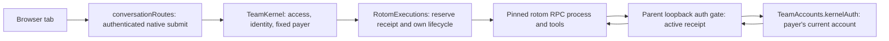

# Architecture

This is the current **rotom team** architecture. [PRODUCT.md](PRODUCT.md) and
[CONFIGURATION.md](CONFIGURATION.md) define the product contract; [map.md](map.md) locates the code.
Pi Durable remains shared storage infrastructure. Its legacy agent execution path is separate from the default
rotom execution path. Neither the proposed storage worker nor used-process idle eviction is implemented here.

## Execution and trust boundary

`bin/rotom-team.js` isolates the data/agent directories before loading `src/server/main.ts`.
The server defaults to kernel mode. `PocketApp.#open` opens the shared Harness and creates `TeamKernel`;
it does **not** load service extension modules in kernel mode.



The diagram describes the current native path, not a worker design. Its entry points are
`http/conversation-routes.ts: conversationRoutes`, `TeamKernel.submit/#submit/#check`,
`RotomExecutions.run/#launch`, and `rotom-kernel.ts: startRotomKernel`.
A native session cannot fall back to Durable execution when the kernel is disabled: the route rejects it;
`TeamExecution.admit/authorize` also reject native sessions.

A native process runs with the trusted host user's privileges. A member HOME, environment filtering and an auth
gate enforce product routing, **not an OS sandbox**. Native extensions and tools remain trusted code.
`rotom-kernel.ts: startRotomKernel` and `rotom-resource-policy.ts` enforce launch policy; they do not make
untrusted team members safe to host. Do not remove their checks on the assumption that HOME is isolation.

## Personal credentials and who pays

- `team-accounts.ts: createRuntime` disables ambient credential lookup. `TeamAccounts.#open` owns each
  member's `people/<id>/auth.json`, `profile.json`, `models-store.json` and refresh coordination.
  `credential-store.ts: FileCredentials` is the credential-store adapter. The native broker HOME is **not**
  another OAuth refresh writer.
- `TeamKernel.binding/#ref/#check` bind the member, account generation, model, workspace, configuration and
  kernel version. Membership, visibility, driving permission and account/model identity are checked again at
  inference. The request's author does not silently replace an active run's payer.
- `RotomExecutions.#launch` owns the loopback gate and its secret file. It checks the active receipt, bearer
  token, provider/model and abortion state before and after async authorization.
  `rotom-policy.mjs` calls this gate for native inference; `TeamAccounts.kernelAuth` returns request-scoped
  auth, not a refresh-capable stored grant. Native refresh requests are rejected by the TeamKernel callback.
- `TeamKernel.handoff` and `RotomExecutions.handoff/#seed` are explicit ownership/history transitions.
  Public history is copied; private reasoning/signatures do not become another member's prompt.
  `TeamKernel.snapshot` reports native cost status as unknown; shared transcript attribution is not proof
  of provider billing.
- Legacy Durable dispatch also uses personal routes: `TeamExecution.admit/authorize`, `TeamRunDoc` and
  `TeamAccounts`, not a shared owner account. `attribution.ts: requesterOf` and `requests.ts` retain
  authorship and legacy workflow attribution; they are not the native payer authority.

## Persistent truth, mirror and live state

```mermaid
flowchart LR
    Native[Native session JSONL and RPC events] --> Journal[RotomJournal: receipts, entries and raw usage]
    Journal --> Mirror[TeamKernel.mirror / #mirrorNow]
    Mirror --> Durable[Harness commit: public native entries and NativeMirrorDoc count]
    Durable --> Room[Room shared view]
    Native -. provisional events via TeamKernel.#observe .-> Live[In-memory clientLive / roomState]
    Live -.-> Room
    Room --> Tab[Browser]
```

| Owner              | Durable state and invariant                                                                                                                                | Code                                                                                 |
| ------------------ | ---------------------------------------------------------------------------------------------------------------------------------------------------------- | ------------------------------------------------------------------------------------ |
| Native process     | Native JSONL/session identity; acknowledged state and finalization must be read back                                                                       | `RotomExecutions.#execute`, `readNativeSnapshot`, `rotom-rpc.ts: RotomRpc`           |
| Kernel journal     | `kernel.sqlite`: immutable attempt binding, receipts, segments/heads, entries, usage and resume plans; a pending/unknown operation fences its conversation | `RotomJournal.reserve/attach/progress/finish`                                        |
| Shared Harness     | `pocket.sqlite`: conversations, collaborative documents, tasks and public native-entry mirrors; not the engine executing native tools                      | `PocketApp.#open`, `docs.ts`, `team-kernel.ts: NativeMirrorDoc`                      |
| Mirror coordinator | Serializes mirrors per conversation; the stored count is an entry count, not a rowid; in-memory cursor advances only after a successful Durable commit     | `TeamKernel.mirror/#mirrorNow`, `RotomJournal.entryCursor/entriesAfter`              |
| Live view          | Streaming text/tools, dialogs, statuses and widgets are provisional; tabs may also show their own optimistic send                                          | `TeamKernel.#observe/clientLive/roomState`, `web/store.js: actions.submit/applyView` |

Handoff seeds are excluded from mirrored entry enumeration by `RotomJournal.entriesAfter`, so copied history
is not appended twice. `team-kernel.ts: publicEntry` strips private assistant
parts from the shared mirror. Do not treat live text, HTTP acceptance or a missing PID as a settled receipt.
Changing stored document kind/scope/history/fork semantics is not a documentation cleanup.

Both stores currently run in the server process; `RotomJournal` uses synchronous SQLite.
The D8 worker is a future change, not an existing ownership boundary.
See [map.md](map.md#data) for file ownership and [CONFIGURATION.md](CONFIGURATION.md) for retention/configuration.

## Startup and recovery order

The normal path in `PocketApp.#open` is:

1. Verify the native pin in kernel mode; take `harness.lock`. In non-kernel mode,
   `requireNoPendingKernel` checks that native work is not being bypassed.
2. Initialize push/settings/HTTP and `TeamAccounts`. Install core tasks and the identity extension.
   Only non-kernel mode creates `ExtensionLoader` and loads service extensions.
3. Open `pocket.sqlite` and `Harness`; then create `TeamKernel`/`RotomExecutions`.
   `RotomJournal` takes `kernel.lock`, opens its own store and marks unfinished dispatch intents unknown.
4. `PocketApp.#recover` rebuilds shared session/agent/chat/profile/subagent indexes and repairs authors.
   `TeamKernel.reconcile` reconciles native metadata and catches mirrors up; it does not replay provider work.
5. `TeamExecution.recover` rebuilds legacy owner/provider-session indexes, then `spend.load` restores
   the shared spend view.
6. Subscribe to commits, approvals and browser events. Warm the legacy guard only when enabled.
7. Call `harness.resume()`, then schedule `TeamKernel.resumeInterrupted()`.

The last method's name is **not** permission to replay an unknown result. It requires a persisted pending plan
and an eligible **settled** prompt receipt, rechecks the member, and submits a new continuation with the existing
chain limit. Unknown/interrupted receipts and unresolved command inputs stay fenced.
See `TeamKernel.resumeInterrupted` and `RotomJournal.canResume/planResume`.

A stale kernel lock is not broken just because its parent PID disappeared. Native/tool descendants may still
be running (`RotomJournal.constructor`). Recovery and backup must preserve that uncertainty.

## Commit coordination and delivery

`rotom-control.ts: decodeNativeControl` owns validation of the five existing Team notify envelopes.
`RotomRpc.#consume` validates before any reader sees a control; adapters keep nonce correlation at their request
boundary. A WeakMap shares decoding within one unchanged RPC event without retaining past events. TeamKernel routes
ordinary notifications to notices, children reports to live state, and other controls only to their private readers.
Reserved malformed/unknown controls fail the transport with an unknown outcome, never success or automatic replay;
neither the wire format nor the native policy sender is changed.

`PocketApp.#committed` processes usage first, then document/submission changes; `#documentCommitted`
updates memory and schedules rooms/session lists. This shared coordinator remains relevant in kernel mode because
native public entries are committed through the Harness. It does not run native inference or settle native receipts.
Commit listeners cannot reenter Harness session APIs; attribution writes are deferred.

`Room.schedule/pushAll` coalesce room work (90 ms), and `schedulePeek` coalesces peeks (1 s).
`PocketApp.#scheduleSessions` coalesces session-list updates (400 ms).
`Room.pushAll` shares field projection/serialization for one fanout; each client retains its own full/delta,
sequence and live-delta state. This is not a cross-push cache of viewer permissions.

`http/events.ts: createEventStreams` supplies SSE and long polling. On attach, `PocketApp.attach` sends
hello/session state and opens a room for its full view. Poll overflow disconnects instead of reporting a partial
view as success; `web/store.js: pollEvents` resets its ACK when the server assigns a new poll session.
A normal session switch still creates a new subscription/connection through `connect`; D5 is not implemented.

## Shutdown and safe continuation

Normal shutdown has two layers:

1. `main.ts: stop` stops watchers, closes the HTTP listener/connections and awaits `PocketApp.close`
   with a bounded deadline; it then stops the performance journal and exits.
2. `PocketApp.close` stops app timers/subscriptions and the legacy loader, tells clients it is closing,
   closes room/provider UI state, then awaits `TeamKernel.close`.
3. `TeamKernel.close` stops admission/MCP sign-ins, plans continuations only for eligible active prompts,
   aborts active runs and waits for their settlement, then calls `RotomExecutions.close`.
4. `RotomExecutions.close` refuses an active execution, waits for warming, retires native processes and their
   auth gates, then closes `RotomJournal` (database and kernel lock). This is not an idle-eviction policy.
5. Only after native closure does `PocketApp.close` close the Harness, clean environments/browser resources,
   flush coalesced configuration writes and release `harness.lock`.

These are the successful ordering guarantees, not proof that an error or deadline closed every descendant.
A failed close does not authorize deleting a kernel lock, replaying an unknown tool request, or calling the result
interrupted merely because the process is gone. Tests of closure and recovery are listed in
[VERIFICATION.md](VERIFICATION.md).

## Requests, resources and legacy boundaries

- `http.ts: createHandler` owns the HTTP error boundary; `http/api.ts: createApi` authenticates and
  checks the X-Pocket guard before conversation routing. `PocketApp.requireSee/requireSteer/requireDriver`
  and TeamKernel perform the operation-specific access checks. Personal sign-in routes call `Providers` with
  the acting user; they are not an owner-only shared credential panel.
- Local Markdown download links use `/api/c/:id/download`. `conversationRoutes` checks visibility and
  `Workspace.readableFile` before `serveDownload`; PDFs are inline, other files are attachments with a sandbox
  policy. `serveImage` remains image-only. UI handling is in `web/ui.js`.
- `rotom-kernel.ts: startRotomKernel` and `rotom-child.sh` disable default skill discovery.
  `rotom-skills.mjs` supplies project resources through the pinned resolver; bundled parent and explicit frozen
  skills still load. Personal skill settings/files are ignored, not removed. Other personal configuration remains
  policy-checked. `rotom-child.ts` validates each child before launch.
- **Legacy service extensions only:** `src/server/extensions/`, data-folder drop-ins, `PocketHost`,
  `ExtensionLoader`, Lancet Guard and the service browser tool belong to the non-kernel branch.
  `PocketApp.#open` and `main.ts` do not load/watch that extension directory in kernel mode.
  Team uses native Agent Extensions; see [AGENT-CONFIGURATION.md](AGENT-CONFIGURATION.md).
- `Commands.submit` and Durable generation/task replay remain the legacy execution path.
  Legacy sessions have not yet been switched to read-only archival by D9. Shared storage, author records and
  document definitions remain necessary even if that execution path is later retired.

## The web app

Plain ES modules, served as they are, with no build. Editing a file under `web/` reloads every open tab, and a syntax error blanks the screen for everyone.

**Root and live subscriptions.** `app.js` keeps its original ordered store listener and microtask coalescing.
`store.js: liveOnlyChange` skips a root commit only when live changed, busy did not, and every other state/view field
is unchanged. The eight JSON fields repeated by `room.ts` are compared by value and key iteration order (native
statuses/widgets display that order); entries/order and omitted fields use their existing immutable references. This avoids copying/serializing history or changing store data. Other
changes (including permissions, native dialogs/statuses, billing, completion and explicit empty notifications) still
render the root. `Transcript` appends a mount-scoped live subscription, catches up at mount, and removes it on
unmount. Existing store listeners are neither filtered nor reordered. Adding a live consumer outside Transcript
requires revisiting this boundary; busy is already a root dependency.

**Streaming Markdown (`ui.js: Markdown`).** Each mounted component keeps its rendered input/result and the
latest pending input. A single animation-frame callback consumes the latest growing text; repeated parent commits
with unchanged input do not parse again. First render, completion (`cache=true`), conversation and base-path changes
render immediately; completion/unmount cancels pending work. Parsing still runs the full text through marked,
DOMPurify and the existing parts renderer, so references, fences and final folding keep their original semantics.
The 500-entry finished-text LRU is unchanged; no stream versions are added to it. `Transcript` observes content
height to keep following deferred text and loaded images, but does not move a reader who has scrolled up.

**Loading order matters.** `store.js` is the root, and a few modules do work when they load (listed in [map.md](map.md#web-web-preact-and-htm-no-build)). `theme.js` must load before anything that reads `prefs()` as it loads. `store.set` calls subscribers in the order they subscribed. When moving code between modules, keep both orders. `back.js` sits under `store.js` and imports nothing of the app's, so anything may use it.

**History is the back stack (`back.js`).** Only `back.js` writes history. Each route (`/s/12`) and each layer over it (a sheet, the drawer, the launcher, the Files tile or Browser panel where they cover the screen, a file over the tile's tree) is an entry, and each entry says how many layers it stands for and how many steps back the session list's entry is. The app's state is the truth and history follows it a moment later: opening a layer pushes an entry, closing one with a tap goes back past it, and a new route first goes back past the layers above the current one. Back that the person makes closes the layers above the entry it lands on; back to another route reaches `store.js` through `onRoute`. Traversals `back.js` makes itself reach no one. So:

- Navigate with `navigate()` (which calls `pushRoute`); do not call `history.pushState` or `history.back()` elsewhere. To drop a query from the address, use `replaceAddress`, which keeps the entry's marks.
- Something new that covers the screen, or that back should close, is a layer: `useBack(open, close)` in the component that shows it, where `close` makes `open` false. Sheets get theirs from `sheets.js`, one per sheet opened from another (the menu, then the model picker).
- On phones the window clips sideways: the conversation sliding in from the right (a route, a swipe's lean) would make the page wider than the screen, and a phone's browser widen and pan its view to fit.
- A finger's or a mouse's press and click within 280 ms of a layer opening or closing, or a route opening, at a tap (a pointer let go in the 400 ms before) is let go, focus and all: a quick second tap would land on whatever slid in under it (a tile of the sheet that rose, the scrim that closes it). What moves on its own (a reply opening a session, the server closing a sheet, Escape) holds nothing back, and keys and scripts never are.
- New entries wait for the page's first tap or key, since Chrome's back button skips entries a page adds before anyone touches it: the list's entry under a conversation opened straight away on a narrow screen, and the entries of layers already open at load (the chat a notification opened, a panel the tab kept).

**Contracts with the server.**

- Event names and shapes (`hello`, `view`, `chat`, `peek`, …) and the sheet types the server names (`sheet: "chat"`).
- The `pocket.*` keys in local and session storage.
- `ATTACHMENTS_HEADING`, which `ui.js` repeats from `entry-format.ts`.

## Checking a change

- **Every change:** `npm run check` (types, and no unused imports or locals in the TypeScript), `npm run lint`, and `npm test`.
- **Server:** the tests drive a real `PocketApp` with a scripted model, a restart included (`openApp` on the same folder). The built-in browser and peek tiles also run in a real Chromium where one is installed.
- **Web:**
    - `node --check` each file you edit.
    - Then open the app and use what you changed, with the console open.
    - A change that moves code between modules is a move only when the moved code is the same and the loading order above is kept.
